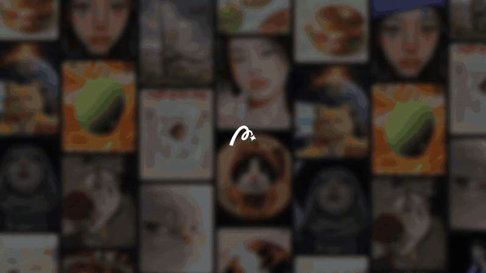

# dsh-promo：用代码复刻一支产品宣传片的结构和节奏（Remotion + Python）

dsh-promo 是一个开源的「代码生成视频」示例：参照 DeepSeek Harness「创造模式」宣传片的分镜结构和卡点节奏，用 Remotion（React 视频框架）逐帧渲染画面，用 Python 合成配乐和 UI 音效，给 MosMos 和 MOSS Create 两个产品各做了一支 99.8 秒的产品宣传片。仓库里有全部代码、工程文件，以及完整的复刻思路和过程；参考片本身不在仓库里，本项目和 DeepSeek、MosMos、MOSS 都没有关系。

如果你想用代码或 AI 辅助做产品宣传片、发布会视频，或者想学分镜复刻和按 BPM 节拍卡点剪辑，这里的流程和代码可以直接拿去改。

English summary is [below](#english).

## 成片预览

### MosMos 宣传片（桌面语音输入工具）

[](preview/mosmos-promo.mp4)

点击动图观看完整 99.8 秒 1080p 成片：[preview/mosmos-promo.mp4](preview/mosmos-promo.mp4)

### MOSS Create 宣传片（AI 图像、视频和配音创作平台）

[](preview/moss-create-promo.mp4)

点击动图观看完整 99.8 秒 1080p 成片：[preview/moss-create-promo.mp4](preview/moss-create-promo.mp4)

动图是从成片里剪的约 15 秒精华片段（800 px 宽，没有声音）。完整 MP4 为了放进仓库压成了 1080p、30 fps，每个约 13 MB；原始母版是 1920×1080、60 fps，可以按下面的步骤自己渲染。

## 模板库

除了上面两支长片，`templates/` 里还有一组短模板。每个模板对着一支公开的产品宣传片逐帧拆解，照它的时长、剪辑点、节拍和运动方式重做一遍，画面和文案全部换成 [MosMos](https://mosmos.io)。目标是攒到 50 个，现在有 22 个。

| 编号 | 名称 | 参考片 | 风格 | 时长 | 预览 |
|---|---|---|---|---|---|
| 01 | MosMos 宣传片 | DeepSeek Harness「创造模式」宣传片 | 深色界面 · 110 BPM 卡点 · 9 段结构 | 99.8 秒 | [GIF](preview/mosmos-preview.gif) |
| 02 | MOSS Create 宣传片 | 同上 | 真实网页录屏 · 卡点剪辑 · 横竖两版 | 99.8 秒 | [GIF](preview/moss-create-preview.gif) |
| 03 | [思考过程，一镜到底](templates/03-claude-extended-thinking/) | [Anthropic · Claude 3.7 Sonnet with extended thinking](https://www.youtube.com/watch?v=t3nnDXa81Hs) | 暖色 UI 演示 · 连续推拉 · 微距 | 39.9 秒 | [GIF](templates/03-claude-extended-thinking/preview.gif) |
| 04 | [线条汇流](templates/04-linear-releases/) | [Linear · Introducing Linear Releases](https://www.youtube.com/watch?v=6dIwFoQ0eVg) | 暗色 3D 倾斜界面 · 线条汇流 · 景深 · 打字收尾 | 30.1 秒 | [GIF](templates/04-linear-releases/preview.gif) |
| 05 | [纸上画出 MosMos](templates/05-linear-orbit/) | [Linear · Orbit (by Linear)](https://www.youtube.com/watch?v=PsY9J2DB1FM) | 黑白微距 · 笔画生长 · 浅景深 · 极简字标 | 28.6 秒 | [GIF](templates/05-linear-orbit/preview.gif) |
| 06 | [蓝底字卡快切](templates/06-arc-live-folders/) | [The Browser Company · Introducing Live Folders in Arc](https://www.youtube.com/watch?v=x1TV6rBi_jM) | 粗体大字卡 · 品牌色满屏 · 屏幕微距 · 快切 | 29.9 秒 | [GIF](templates/06-arc-live-folders/preview.gif) |
| 07 | [大字卡 + 色块分屏](templates/07-notion-ai/) | [Notion · Introducing the new Notion AI](https://www.youtube.com/watch?v=S92KX8-Hmlc) | 暖白大字 · 色块分屏 · 吉祥物头像 | 56.6 秒 | [GIF](templates/07-notion-ai/preview.gif) |
| 08 | [点长成窗口 + 计数徽标](templates/08-claude-haiku/) | [Anthropic · Introducing Claude Haiku 4.5](https://www.youtube.com/watch?v=ccQSHQ3VGIc) | 色底线描插画 · 窗口从一个点长出 · 计数徽标 · 衬线字 + 环绕笔触 | 40.1 秒 | [GIF](templates/08-claude-haiku/preview.gif) |
| 09 | [米白拼贴 + 复古电脑](templates/09-cursor-software-changing/) | [Cursor · Software is changing](https://www.youtube.com/watch?v=2SkrTnGMsr0) | 米白底拼贴 · 复古电脑 · 碎片字 · 彩色几何块 · 打字字卡 | 54.6 秒 | [GIF](templates/09-cursor-software-changing/preview.gif) |
| 10 | [浅灰底产品色阵列](templates/10-apple-homepod-mini/) | [Apple · The new HomePod mini 2](https://www.youtube.com/watch?v=xLL4UnrLNWs) | 浅灰白底 · 产品色彩阵列 · 逐词渐变字 · 极简俯拍 | 40.0 秒 | [GIF](templates/10-apple-homepod-mini/preview.gif) |
| 11 | [黑色缎面 + 玻璃界面微距](templates/11-raycast-new/) | [Raycast · New Raycast. Coming 2026](https://www.youtube.com/watch?v=Mi173xGb0ZA) | 黑色缎面 3D 背景 · 玻璃质感界面微距 · 浅景深 · 黑底等宽小字收尾 | 38.6 秒 | [GIF](templates/11-raycast-new/preview.gif) |
| 12 | [云雾渐变 + 套件分章](templates/12-superhuman/) | [Superhuman · Superhuman](https://www.youtube.com/watch?v=4XKq7qGnJus) | 云雾渐变底 · 悬浮产品界面 · 米色图标转场 · 套件式分章 | 60.4 秒 | [GIF](templates/12-superhuman/preview.gif) |
| 13 | [浅灰打字字卡 + 壁纸上的应用窗口](templates/13-cursor-agents/) | [Cursor · Introducing Cursor 2.0 and Composer](https://www.youtube.com/watch?v=An8IM-kPyms) | 浅灰打字字卡 · 柱状对比 · 壁纸上的应用窗口 · 黑底标志收尾 | 64.5 秒 | [GIF](templates/13-cursor-agents/preview.gif) |
| 14 | [灰色画布 + 多人光标](templates/14-figma-code-layers/) | [Figma · Code Layers](https://www.youtube.com/watch?v=UMDUAHmhkT8) | 灰色画布 · 多人光标 · 手机画板 · 等宽字墙 · 像素块收尾 | 34.9 秒 | [GIF](templates/14-figma-code-layers/preview.gif) |
| 15 | [品牌蓝粗体字卡 + 侧栏微距](templates/15-arc-tidy-tabs/) | [The Browser Company · Tidy Tabs by Arc](https://www.youtube.com/watch?v=DHTmMtJzRrc) | 品牌蓝粗体字卡 · 侧栏微距 · 风景壁纸 · 一键整理 | 20.6 秒 | [GIF](templates/15-arc-tidy-tabs/preview.gif) |
| 16 | [手绘小人 + 蓝框页面 + 卡片墙](templates/16-notion-agents/) | [Notion · Introducing Notion 3.0 · Agents](https://www.youtube.com/watch?v=R1cF4T4lgI4) | 手绘小人 · 蓝框页面 · 超大打字 · 声波 · 卡片墙 | 90.0 秒 | [GIF](templates/16-notion-agents/preview.gif) |
| 17 | [白底产品摄影 + 细小字卡](templates/17-op1-field/) | [teenage engineering · introducing OP–1 field](https://www.youtube.com/watch?v=Fab7sp30pg0) | 白底产品摄影 · 键帽微距 · 细小字卡逐词替换 · 漏光收尾 | 28.1 秒 | [GIF](templates/17-op1-field/preview.gif) |
| 18 | [暗色倾斜界面 + 浅景深](templates/18-linear-agent/) | [Linear · Introducing Linear Agent](https://www.youtube.com/watch?v=mRql2VJ99gM) | 暗色倾斜界面 · 浅景深 · 低调对话 · 发光字收尾 | 54.9 秒 | [GIF](templates/18-linear-agent/preview.gif) |
| 19 | [白底黑色输入胶囊 + 生成页面](templates/19-vercel-v0/) | [Vercel · Introducing v0: Generative UI](https://www.youtube.com/watch?v=By9wCB9IZp0) | 白底黑色输入胶囊 · 逐句提示词 · 生成页面推近 · 作品墙 | 47.5 秒 | [GIF](templates/19-vercel-v0/preview.gif) |
| 20 | [黑底玻璃界面 + 着色器字](templates/20-framer-shaders/) | [Framer · Framer Update: Interactive Shaders](https://www.youtube.com/watch?v=rwMJ08sXNOA) | 黑底玻璃界面 · 霓虹字 · 镀铬圆环 · 属性面板 · 长时间漂浮 | 80.3 秒 | [GIF](templates/20-framer-shaders/preview.gif) |
| 21 | [星球地平线 + 快切任务卡](templates/21-kimi-swarm/) | [Moonshot AI (Kimi) · Meet Kimi K2.6 Agent Swarm](https://www.youtube.com/watch?v=v7IJ8JNUNQ8) | 星球地平线 · 胶囊标题 · 快切任务卡 · 翻转方块墙 | 37.4 秒 | [GIF](templates/21-kimi-swarm/preview.gif) |
| 22 | [米色纸面 + 橙色八角框](templates/22-claude-memory/) | [Anthropic · Claude now has memory](https://www.youtube.com/watch?v=PupmfSttxlc) | 米色纸面 · 手绘线条 · 设置卡片 · 橙色八角框 · 纸折信封 | 59.0 秒 | [GIF](templates/22-claude-memory/preview.gif) |

从模板 12 开始，参考片里的实拍和照片会换成许可允许再分发的公开素材，署名见 [docs/assets-credits.md](docs/assets-credits.md)。

每个模板目录里有 `analysis.md`（参考片逐镜拆解，纯文字）、`README.md`（复刻了什么、关键数字、怎么渲染）、`preview.gif` 和完整的 720p `preview.mp4`。03 以后的模板共用 `templates/_engine/` 里的 Remotion 工程、组件和配乐合成器，渲染一个模板只要一条命令：

```bash
cd templates/_engine && npm install
RENDER_DIR=/tmp/renders scripts/render.sh 06-arc-live-folders
```

候选参考片一共整理了 62 支（Anthropic、OpenAI、Cursor、Linear、Notion、Figma、Apple 等 19 家），标题、年份、时长、风格和是否适合复刻都在 [docs/reference-catalog.md](docs/reference-catalog.md)。

## 关键数据（01、02 两支长片）

| 项目 | 数值 |
|---|---|
| 片长 | 99.8 秒（5989 帧） |
| 分辨率 / 帧率 | 1920×1080，60 fps；MOSS Create 另有重新排版的 1080×1920 竖版 |
| 镜头数 | 37 个镜头 + 14 个镜头内小切，成片里计划的剪辑点共 51 个 |
| 节拍 | 110 BPM，所有剪辑点吸附到八分音符网格（0.2727 秒） |
| 段落 | 照参考片的 9 段结构和时长比例 |
| 响度 | −14 LUFS，真峰值约 −0.5 dB |
| 配乐 | numpy / scipy 合成，没有用任何采样 |

## 怎么用代码做一支产品宣传片？

画面写成 React 组件，交给 Remotion 一帧一帧渲染成视频；时间线、打字内容和音效事件写在一个 Python 脚本里，生成 `timeline.json`，画面和音效都读这一份，所以声画不会错位。配乐也用代码合成，最后用 ffmpeg 混音、做响度标准化。改文案或节奏，只要改 `build/timeline.py` 和 `remotion/src/Film.tsx` 再重新渲染。

## 分镜复刻：复刻一支宣传片要几步？

我们的做法分 7 步，细节都在 [docs/method.md](docs/method.md)：

1. **拆到帧**：ffprobe 量基本参数，按 5 fps 抽帧通读；逐帧算亮度差找硬切，软转场对着抽帧人工定时间，整理出 37 个镜头和 14 个镜头内小切；把屏幕上的文字逐张抄下来再核对。
2. **找真实节拍**：librosa 直接给出 143.6 BPM，但对不上剪辑点。对 onset 包络做自相关，间隔落在 0.273 / 0.819 / 1.091 / 2.183 秒，算出真实速度是 110 BPM，3-3-2 切分把自动检测带偏了。60–72 秒是半速段。
3. **网格对齐**：每个镜头的入点取参考片对应时刻，再吸附到最近的八分音符。吸附后和参考片的偏差最大约 0.13 秒，和节拍网格的偏差不超过 8 ms。
4. **段落对位**：参考片的 9 段和比例照搬，每一段换上目标产品里功能相当的东西，文案只用产品官网上有的说法。
5. **做产品画面**：MOSS Create 用 Playwright + CDP 录真实网页；MosMos 是桌面软件，照官网演示组件重画。
6. **合成配乐和音效**：110 BPM 的鼓、贝斯、琶音和铺底，半速段和加速段放在参考片同样的位置；键盘声、点击、甩出、故障声都挂在时间线事件上。
7. **检查**：每个镜头取静帧逐张看，ffprobe 核规格，`scdet` 扫剪辑点和计划逐个对，ebur128 量响度，再把参考片和成片左右并排、分声道戴耳机看一遍。

逐镜头时间、画面描述、节拍和配色见 [docs/reference-analysis.md](docs/reference-analysis.md)（纯文字，没有画面）。

## 需要什么工具？

- Node.js 20 以上（我们用的是 24），Remotion 4.0.539（`npm ci` 会装好）
- ffmpeg（7.x 可以）
- Python 3，需要 `numpy scipy pillow`
- 字体：Noto Sans CJK SC、Inter、Geist、Geist Mono，要装成系统字体。Debian / Ubuntu 上 `apt install fonts-noto-cjk`，Inter 和 Geist 可以从 Google Fonts 下载。没装中文字体会出现方块字。
- 只有重新抓 MOSS Create 素材时才需要 Playwright（`tools/package.json`，`npx playwright install chromium`）
- 渲染用 `--gl=swangle`，没有 GPU 的服务器也能跑。一支横版大约 6–7 分钟（7 并发）。

## 怎么重建

完整命令在 [mosmos/PROGRESS.md](mosmos/PROGRESS.md) 和 [moss-create/PROGRESS.md](moss-create/PROGRESS.md)。大致顺序：

```bash
cd mosmos                      # 或 moss-create
python3 build/timeline.py && cp build/timeline.json remotion/src/
cd audio && python3 audio.py && cd ..     # 再按 PROGRESS.md 做两遍 loudnorm，得到 audio/mix.wav
cd remotion && npm ci && npx remotion render src/index.ts Mosmos ../build/silent.mp4 --codec h264 --crf 17 --gl=swangle --muted
cd .. && build/finish.sh
```

MOSS Create 的合成名叫 `Moss`（横版）和 `MossV`（竖版）。渲染前要先按 [moss-create/assets/README.md](moss-create/assets/README.md) 把录屏和模板素材抓回来，仓库里没有这些，直接渲染会缺文件。

## 常见问题

**和 DeepSeek 有关系吗？** 没有。DeepSeek Harness 的宣传片只是结构和节奏的参考，仓库里没有它的视频、音频或截图。

**能拿来做自己产品的宣传片吗？** 可以。代码是 MIT 协议。换产品主要改三处：`build/timeline.py` 的镜头和文案、`remotion/src/Film.tsx` 的画面、`remotion/public/` 的素材。

**为什么 BPM 检测结果是 143.6，实际是 110？** 3-3-2 节奏型的重音间隔是 0.819 秒，折算约 146 BPM，自动检测被它带偏。用自相关看几个间隔之间的比例关系更可靠。

**横版和竖版是一套代码吗？** MOSS Create 是。所有界面镜头写成「缩放 + 焦点坐标」，横版按这个推拉，竖版用同一个焦点裁更窄的区域，是重新排版而不是加黑边。MosMos 的竖版做得早，还是居中加模糊垫底。

## 目录

| 路径 | 内容 |
|---|---|
| `docs/method.md` | 复刻思路和过程：拆片、对节拍、做画面和配乐、检查、踩过的坑 |
| `docs/reference-analysis.md` | 参考片拆解：逐镜头表、节拍、配色、段落比例（纯文字） |
| `mosmos/build/` | `timeline.py`（37 个镜头 + 打字和音效事件）、`shotlist.py`、`finish.sh` |
| `mosmos/audio/audio.py` | 配乐和 UI 音效合成 |
| `mosmos/remotion/src/` | `Film.tsx`（每个镜头的画面）、`lib.tsx`（打字、光标、logo 等组件） |
| `mosmos/remotion/public/` | MosMos 官网的 logo 和插画纹理 |
| `mosmos/ref/shots.py` | 参考片镜头表，给 `shotlist.py` 对照用 |
| `mosmos/mosmos-shotlist.md` | 镜头对照表 |
| `moss-create/` | 结构同上；remotion 里多了竖版构图 `MossV` |
| `moss-create/tools/` | 抓 create.moss.cn 截图、录屏、模板素材的 Playwright 脚本 |
| `moss-create/assets/README.md` | 哪些素材没放进仓库、为什么、怎么重新抓 |
| `moss-create/mossland-shotlist.md` | 镜头对照表 |
| `preview/` | 两支完整成片（1080p / 30 fps）和预览动图 |
| `templates/_engine/` | 模板共用的 Remotion 工程、组件（`src/mos.tsx`、`src/kit.tsx`）、配乐合成器（`audio/synth.py`）和渲染、检查脚本 |
| `templates/NN-*/` | 单个模板：`Film.tsx`、`timeline.py`、`audio.py`、`meta.json`、`analysis.md`、预览 |
| `docs/reference-catalog.md` | 62 支候选参考片的目录 |

## 技术栈

Remotion 4（React + TypeScript）、ffmpeg、Python（numpy、scipy、Pillow、librosa 用于分析）、Playwright（Chrome DevTools Protocol 录屏）。

## 版权和声明

- **参考片**：DeepSeek Harness「创造模式」宣传片，版权归原作者。仓库里没有它的视频、音频、截图或缩略图，`docs/` 里只有文字拆解（镜头时间、画面描述、屏幕上的文字）。
- **MOSS Create 成片里的模板内容**：画面中出现的模板封面和预览视频是 create.moss.cn 上社区用户的作品，有些带第三方品牌，版权归各自作者和品牌方，片中只是按网站原样录屏展示。
- **产品名称和标志**：MosMos、MOSS Create、DeepSeek 等名称和 logo 归各自所有者。`mosmos/remotion/public/` 里的 logo 和纹理取自 mosmos.io，`moss-create/remotion/public/logo.svg` 取自 create.moss.cn，放在这里只是为了能把工程跑起来。
- **这不是官方宣传片**。两支片子是练手和方法演示，和 DeepSeek、MosMos、MOSS 都没有关系。
- MosMos 是要安装的桌面软件，我们没有真实录屏，界面是照官网演示重画的。MOSS Create 用的是不登录时的真实录屏和截图，没法展示生成过程和结果。
- 代码按 MIT 协议开源（见 [LICENSE](LICENSE)），协议不覆盖上面提到的第三方内容。引用本项目可以用 [CITATION.cff](CITATION.cff)。

作者：[LaplaceYoung](https://github.com/LaplaceYoung)

---

<a id="english"></a>

## English

**dsh-promo** is an open-source example of programmatic video: two 99.8-second product launch videos (motion graphics) built entirely in code. The cut structure and beat timing follow the DeepSeek Harness "Create Mode" promo as a structure reference; visuals are rendered frame by frame with Remotion (React), and the music and UI sound effects are synthesized in Python with no samples. The two films are for MosMos (a desktop voice-input app) and MOSS Create (an AI image, video and voice creation platform). This project is not affiliated with DeepSeek, MosMos or MOSS, and the reference film is not included.

**Previews:** click the animated previews above, or open the full films directly: [MosMos (1080p, 99.8 s)](preview/mosmos-promo.mp4) · [MOSS Create (1080p, 99.8 s)](preview/moss-create-promo.mp4).

**Key facts:** 99.8 s, 1920×1080 at 60 fps (plus a re-laid-out 1080×1920 vertical cut for MOSS Create), 37 shots plus 14 in-shot sub-cuts (51 planned cuts), 110 BPM with every cut snapped to an eighth-note grid, the reference's 9-part act structure and proportions, mastered to −14 LUFS.

**How it was made (7 steps, full write-up in Chinese in [docs/method.md](docs/method.md)):**

1. Break the reference down to frames: frame-difference cut detection, manual timing for soft transitions, on-screen text transcription.
2. Find the real tempo: librosa reported 143.6 BPM; autocorrelation of the onset envelope showed 110 BPM with a 3-3-2 syncopation and a half-time section at 60–72 s.
3. Snap every shot's in-point to the nearest eighth note (max 0.13 s from the reference, ≤ 8 ms from the grid).
4. Map each act of the reference to an equivalent feature of the target product, using only wording from the product's own site.
5. Capture product footage: real browser recordings via Playwright + CDP screencast for MOSS Create; redrawn UI for MosMos (desktop app).
6. Synthesize music and foley with numpy/scipy, driven by the same `timeline.json` as the visuals.
7. QA: per-shot stills, ffprobe specs, `scdet` cut scan against the plan, EBU R128 loudness, side-by-side review with the reference.

Shot-by-shot breakdown of the reference (text only): [docs/reference-analysis.md](docs/reference-analysis.md).

**Template library:** `templates/` holds short MosMos motion-design templates, each a frame-accurate structural remake of a public product launch video (Anthropic, Linear, The Browser Company, Notion, Cursor, Apple, Raycast, Superhuman, Figma, teenage engineering, Vercel, Framer, Moonshot AI so far): same length, cut points, tempo and camera moves, with MosMos content, synthesized music and, from template 12 on, openly licensed stock photos, video, CC0 sound effects and OFL fonts where the reference uses live action (credited in docs/assets-credits.md). Twenty-two templates exist (01–22, goal: 50); each folder has a text-only shot breakdown, a GIF and a 720p MP4 preview. All templates share one Remotion engine in `templates/_engine/` (`scripts/render.sh NN-slug`). The 62-video reference catalog is in [docs/reference-catalog.md](docs/reference-catalog.md).

**Rebuild:** Node.js 20+, Remotion 4.0.539, ffmpeg 7, Python 3 with `numpy scipy pillow`, and the fonts Noto Sans CJK SC, Inter, Geist, Geist Mono. Commands are in [mosmos/PROGRESS.md](mosmos/PROGRESS.md) and [moss-create/PROGRESS.md](moss-create/PROGRESS.md). MOSS Create footage and template media are not in the repo; recapture them first with the scripts described in [moss-create/assets/README.md](moss-create/assets/README.md).

**License and rights:** code is MIT ([LICENSE](LICENSE)). The reference film, product names and logos belong to their owners; community template works shown in the MOSS Create film belong to their creators. These are not official promos.

Author: [LaplaceYoung](https://github.com/LaplaceYoung)
