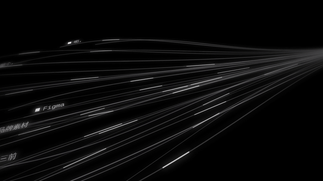

# 模板 04 · 线条汇流

参考片：[Introducing Linear Releases](https://www.youtube.com/watch?v=6dIwFoQ0eVg)（Linear，2026）

风格：暗色 3D 倾斜界面 · 线条汇流 · 景深 · 等宽字打字收尾

## 复刻了什么

- 纯黑底、冷白细线从左散开向右汇聚，3D 倾斜面板和窄带景深。
- 线条上的工单号换成场景词、口头语和热词，汇聚点从版本号换成「已写好 ✓」。
- 中段字卡「你在哪里说，决定我们怎么写」，三块面板对应邮件、文档、代码与终端。
- 方块光标打出「语音输入」、整词删掉、再打出「现在，开口就好」，接 logo。

画面里的产品、文案和界面都来自 [mosmos.io](https://mosmos.io)。音乐是用 numpy 合成的，没有用任何采样或参考片的音频。参考片只用来量时间和看运动方式，仓库里没有它的任何画面、音频或视频。

## 关键数字

| 项目 | 参考片 | 本模板 |
|---|---|---|
| 时长 | 30.07 秒 | 30.067 秒 |
| 帧率 | 60 | 60 |
| 画幅 | 1920×960 | 1920×1080 |
| 剪辑点 | 7 个 | 7 个，时间相同（误差不超过 1 帧） |
| 速度 | 110 BPM | 110 BPM |
| 响度 | −24.7 LUFS | −15.2 LUFS |

成片响度 −15.2 LUFS，比目标 −14 低约 1 dB：参考片本身很安静，铺底动态小，两遍 loudnorm 后没有再强推。

## 预览



完整版（720p）：[preview.mp4](preview.mp4)

## 怎么渲染

```bash
cd templates/_engine
npm install
RENDER_DIR=/tmp/renders scripts/render.sh 04-linear-releases
python3 scripts/qa.py ../04-linear-releases /tmp/renders/04-linear-releases.mp4   # 可选：剪辑点、响度和抽帧检查
```

`render.sh` 依次运行 `timeline.py`（剪辑点和音效事件）、`audio.py`（合成音乐，归一到 −14 LUFS）、Remotion 渲染，再合成 1080p 成片，并在本目录生成 `preview.mp4` 和 `preview.gif`。中间文件写在 `build/`，不进仓库。

## 文件

- `Film.tsx`：画面
- `timeline.py` / `timeline.json`：剪辑点、换字时间、音效事件
- `audio.py`：配乐和音效
- `meta.json`：规格和参考片信息
- `analysis.md`：参考片逐镜拆解
