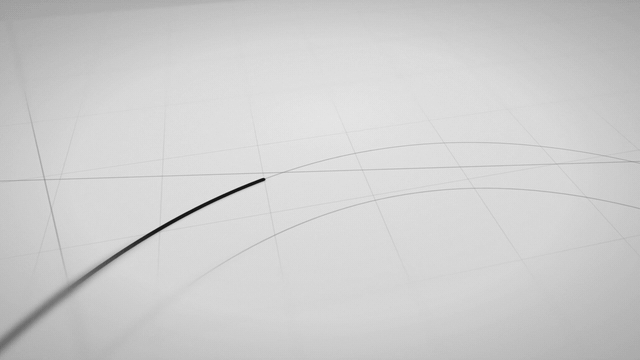

# 模板 05 · 纸上画出 MosMos

参考片：[Orbit (by Linear)](https://www.youtube.com/watch?v=PsY9J2DB1FM)（Linear，2026）

风格：黑白微距 · 纸面构线 · 笔画生长 · 浅景深 · 极简字标

## 复刻了什么

- 黑白绘图纸微距、窄带景深、纸面颗粒，墨线一笔一笔描出来，笔画顺序和时长照参考片。
- 描边字标以极强透视出现，再切到正面的 MosMos 字标，失焦后出平台信息，最后交叉淡化到 mosmos.io。
- 前 9.4 秒只有合成的笔尖划纸声，之后进入 123 BPM 的电子钢琴铺底，和参考片的声音结构一致。

画面里的产品、文案和界面都来自 [mosmos.io](https://mosmos.io)。音乐是用 numpy 合成的，没有用任何采样或参考片的音频。参考片只用来量时间和看运动方式，仓库里没有它的任何画面、音频或视频。

## 关键数字

| 项目 | 参考片 | 本模板 |
|---|---|---|
| 时长 | 28.61 秒 | 28.604 秒 |
| 帧率 | 48 | 48 |
| 画幅 | 1920×1080 | 1920×1080 |
| 剪辑点 | 6 个 | 6 个，时间相同（误差不超过 1 帧） |
| 速度 | 123 BPM | 123 BPM |
| 响度 | −21.9 LUFS | 约 −14 LUFS |

## 预览



完整版（720p）：[preview.mp4](preview.mp4)

## 怎么渲染

```bash
cd templates/_engine
npm install
RENDER_DIR=/tmp/renders scripts/render.sh 05-linear-orbit
python3 scripts/qa.py ../05-linear-orbit /tmp/renders/05-linear-orbit.mp4   # 可选：剪辑点、响度和抽帧检查
```

`render.sh` 依次运行 `timeline.py`（剪辑点和音效事件）、`audio.py`（合成音乐，归一到 −14 LUFS）、Remotion 渲染，再合成 1080p 成片，并在本目录生成 `preview.mp4` 和 `preview.gif`。中间文件写在 `build/`，不进仓库。

## 文件

- `Film.tsx`：画面
- `timeline.py` / `timeline.json`：剪辑点、换字时间、音效事件
- `audio.py`：配乐和音效
- `meta.json`：规格和参考片信息
- `analysis.md`：参考片逐镜拆解
