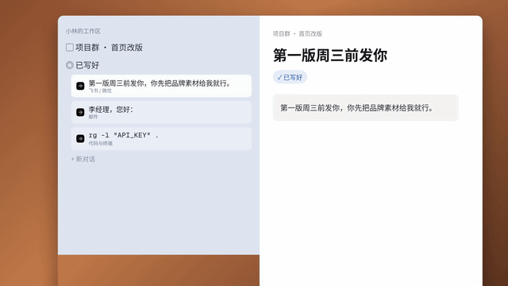

# 模板 06 · 蓝底字卡快切

参考片：[Introducing Live Folders in Arc | Your sidebar is alive](https://www.youtube.com/watch?v=x1TV6rBi_jM)（The Browser Company，2024）

风格：粗体大字卡 · 品牌色满屏 · 屏幕微距斜拍 · 快切卡点

## 复刻了什么

- 23 个剪辑点和参考片一致，品牌蓝满屏字卡和屏幕微距交替，字卡内换词的时间点也照搬。
- 字卡文字换成 MosMos 的一句话：你说的 / 每句话 / 都写好了 / 飞书 / 微信 / 邮件、文档 / 提示词、终端 / 任意应用都不用离开 / 语音输入 / 现在，开口就好。
- 参考片的真人镜头换成界面：语音胶囊特写、键盘和 Fn 键微距、会议记录面板；致谢叠字换成平台信息。

画面里的产品、文案和界面都来自 [mosmos.io](https://mosmos.io)。音乐是用 numpy 合成的，没有用任何采样或参考片的音频。参考片只用来量时间和看运动方式，仓库里没有它的任何画面、音频或视频。

## 关键数字

| 项目 | 参考片 | 本模板 |
|---|---|---|
| 时长 | 29.95 秒 | 29.933 秒 |
| 帧率 | 23.976 | 30 |
| 画幅 | 1440×1080 | 1920×1080 |
| 剪辑点 | 23 个 | 23 个，时间相同（误差不超过 1 帧） |
| 速度 | 125 BPM | 125 BPM |
| 响度 | −11.9 LUFS | 约 −14 LUFS |

参考片是 4:3、23.976 fps，这里做成 16:9、30 fps，时间点按秒保留。

## 预览



完整版（720p）：[preview.mp4](preview.mp4)

## 怎么渲染

```bash
cd templates/_engine
npm install
RENDER_DIR=/tmp/renders scripts/render.sh 06-arc-live-folders
python3 scripts/qa.py ../06-arc-live-folders /tmp/renders/06-arc-live-folders.mp4   # 可选：剪辑点、响度和抽帧检查
```

`render.sh` 依次运行 `timeline.py`（剪辑点和音效事件）、`audio.py`（合成音乐，归一到 −14 LUFS）、Remotion 渲染，再合成 1080p 成片，并在本目录生成 `preview.mp4` 和 `preview.gif`。中间文件写在 `build/`，不进仓库。

## 文件

- `Film.tsx`：画面
- `timeline.py` / `timeline.json`：剪辑点、换字时间、音效事件
- `audio.py`：配乐和音效
- `meta.json`：规格和参考片信息
- `analysis.md`：参考片逐镜拆解
