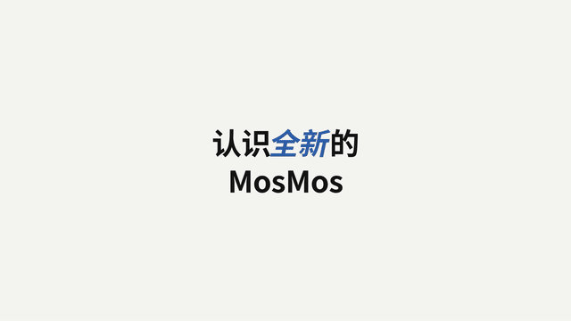

# 模板 07 · 大字卡 + 色块分屏

参考片：[Meet the new Notion AI](https://www.youtube.com/watch?v=S92KX8-Hmlc)（Notion，2024）

风格：暖白底大字 · 色块分屏 · 吉祥物头像 · 功能逐条展示

## 复刻了什么

- 暖白底遮罩升字、胶囊原地换词、图标依次弹出，结构和时间点照参考片的 18 个镜头。
- Notion AI 的头像换成白圈里的 MosMos 像素 logo，下面一条声波，同样会歪头。
- 四个功能段对应 MosMos 的四件事：聊天场景（蓝）、文档写作（红）、会议记录（蓝）、终端命令（黄）。手机段换成终端，因为 MosMos 目前是桌面应用。
- 收尾三步：头像 → 「开口说。就写好。」→ MosMos 字标。

画面里的产品、文案和界面都来自 [mosmos.io](https://mosmos.io)。音乐是用 numpy 合成的，没有用任何采样或参考片的音频。参考片只用来量时间和看运动方式，仓库里没有它的任何画面、音频或视频。

## 关键数字

| 项目 | 参考片 | 本模板 |
|---|---|---|
| 时长 | 56.63 秒 | 56.633 秒 |
| 帧率 | 23.976 | 30 |
| 画幅 | 1920×1080 | 1920×1080 |
| 剪辑点 | 17 个 | 17 个，时间相同（误差不超过 1 帧） |
| 速度 | 105 BPM | 105 BPM |
| 响度 | −22.4 LUFS | 约 −14 LUFS |

参考片 23.976 fps，这里做成 30 fps，时间点按秒保留。

## 预览



完整版（720p）：[preview.mp4](preview.mp4)

## 怎么渲染

```bash
cd templates/_engine
npm install
RENDER_DIR=/tmp/renders scripts/render.sh 07-notion-ai
python3 scripts/qa.py ../07-notion-ai /tmp/renders/07-notion-ai.mp4   # 可选：剪辑点、响度和抽帧检查
```

`render.sh` 依次运行 `timeline.py`（剪辑点和音效事件）、`audio.py`（合成音乐，归一到 −14 LUFS）、Remotion 渲染，再合成 1080p 成片，并在本目录生成 `preview.mp4` 和 `preview.gif`。中间文件写在 `build/`，不进仓库。

## 文件

- `Film.tsx`：画面
- `timeline.py` / `timeline.json`：剪辑点、换字时间、音效事件
- `audio.py`：配乐和音效
- `meta.json`：规格和参考片信息
- `analysis.md`：参考片逐镜拆解
