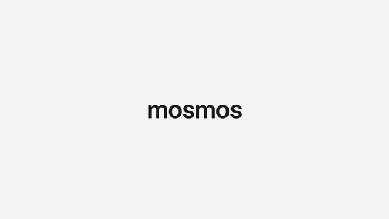

# 模板 10 · 浅灰底产品色阵列

参考片：[The new HomePod mini 2: Rich, room-filling sound in a compact design](https://www.youtube.com/watch?v=xLL4UnrLNWs)（Apple，2026）

风格：浅灰白底 · 产品色彩阵列 · 逐词渐变字 · 极简俯拍

## 复刻了什么

- 小写字标 mosmos 像丝带一样扭转，逐词变色的字卡，结构和时间点照参考片的 14 个剪辑点。
- 不虚构硬件：主角是 MosMos 真实的语音胶囊和圆形录音按钮。彩色圆环按拍出现、换位、拼成花形。
- 巨大的语音胶囊裁在画面下方；五个彩色胶囊一字排开，对应飞书、邮件、文档、提示词、终端。
- 收尾：「Mac 和 Windows 都能用。」→ logo + MosMos + 语音输入 → logo 和一屏小字 → 黑场。官网没有可引用的隐私承诺，所以不写隐私，也不写免费。

画面里的产品、文案和界面都来自 [mosmos.io](https://mosmos.io)。音乐是用 numpy 合成的，没有用任何采样或参考片的音频。参考片只用来量时间和看运动方式，仓库里没有它的任何画面、音频或视频。

## 关键数字

| 项目 | 参考片 | 本模板 |
|---|---|---|
| 时长 | 40.04 秒 | 40.033 秒 |
| 帧率 | 30 | 30 |
| 画幅 | 1920×1080（本地分析用 360p 副本） | 1920×1080 |
| 剪辑点 | 14 个 | 14 个，时间相同（误差不超过 1 帧） |
| 速度 | 87 BPM | 87 BPM |
| 响度 | −16.4 LUFS | 约 −14 LUFS，真峰值不高于 −1.5 dBTP |

帧率同为 30 fps。参考片 1080p 下载被 YouTube 人机验证拦住，分析用的是 360p 副本。

## 预览



完整版（720p）：[preview.mp4](preview.mp4)

## 怎么渲染

```bash
cd templates/_engine
npm install
RENDER_DIR=/tmp/renders scripts/render.sh 10-apple-homepod-mini
python3 scripts/qa.py ../10-apple-homepod-mini /tmp/renders/10-apple-homepod-mini.mp4   # 可选：剪辑点、响度和抽帧检查
```

`render.sh` 依次运行 `timeline.py`（剪辑点和音效事件）、`audio.py`（合成音乐）、`master.py`（归一到 −14 LUFS、限制真峰值）、Remotion 渲染，再合成 1080p 成片，并在本目录生成 `preview.mp4` 和 `preview.gif`。中间文件写在 `build/`，不进仓库。

## 文件

- `Film.tsx`：画面
- `timeline.py` / `timeline.json`：剪辑点、动画时间、音效事件
- `audio.py`：配乐和音效
- `meta.json`：规格和参考片信息
- `analysis.md`：参考片逐镜拆解
