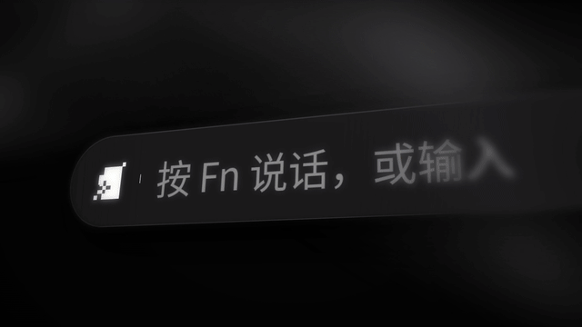

# 模板 11 · 黑色缎面 + 玻璃界面微距

参考片：[New Raycast. Coming 2026](https://www.youtube.com/watch?v=Mi173xGb0ZA)（Raycast，2025）

风格：黑色缎面 3D 背景 · 玻璃质感界面微距 · 浅景深 · 黑底等宽小字收尾

## 复刻了什么

- 黑色缎面背景，玻璃质感的界面斜着拍、只有一条对焦带清楚，结构和时间点照参考片的 13 个剪辑点。
- 搜索框换成「按 Fn 说话，或输入」，打字搜热词；操作菜单换成润色风格；快捷键面板是 Fn + ⇧；剪贴板历史换成今天的输入历史。
- 表情卡片换成场景卡片（飞书、微信、邮件、文档、终端、词库、会议…），在选择框下滑过；然后一颗 MosMos 语音胶囊。
- 后段：场景列表、会议记录窗口、三项整理进度、「正在写好…」；最后是黑底等宽小字「新 场景识别 / 新 热词词库 / 新 会议记录 / 新 MOSMOS」和极小的 logo。

画面里的产品、文案和界面都来自 [mosmos.io](https://mosmos.io)。音乐是用 numpy 合成的，没有用任何采样或参考片的音频。参考片只用来量时间和看运动方式，仓库里没有它的任何画面、音频或视频。

## 关键数字

| 项目 | 参考片 | 本模板 |
|---|---|---|
| 时长 | 38.59 秒 | 38.567 秒 |
| 帧率 | 30 | 30 |
| 画幅 | 1920×1080 | 1920×1080 |
| 剪辑点 | 13 个 | 13 个，时间相同（误差不超过 1 帧） |
| 速度 | 129 BPM | 129 BPM |
| 响度 | −13.2 LUFS | 约 −14 LUFS，真峰值不高于 −1.5 dBTP |

帧率同为 30 fps。

## 预览



完整版（720p）：[preview.mp4](preview.mp4)

## 怎么渲染

```bash
cd templates/_engine
npm install
RENDER_DIR=/tmp/renders scripts/render.sh 11-raycast-new
python3 scripts/qa.py ../11-raycast-new /tmp/renders/11-raycast-new.mp4   # 可选：剪辑点、响度和抽帧检查
```

`render.sh` 依次运行 `timeline.py`（剪辑点和音效事件）、`audio.py`（合成音乐）、`master.py`（归一到 −14 LUFS、限制真峰值）、Remotion 渲染，再合成 1080p 成片，并在本目录生成 `preview.mp4` 和 `preview.gif`。中间文件写在 `build/`，不进仓库。

## 文件

- `Film.tsx`：画面
- `timeline.py` / `timeline.json`：剪辑点、动画时间、音效事件
- `audio.py`：配乐和音效
- `meta.json`：规格和参考片信息
- `analysis.md`：参考片逐镜拆解
