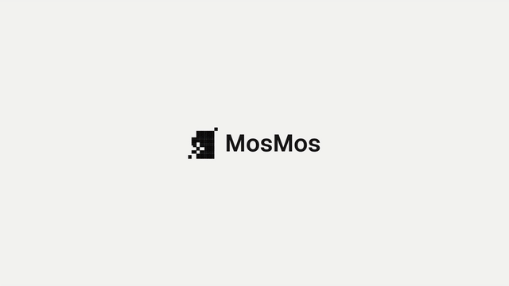

# 模板 13 · 浅灰打字字卡 + 壁纸上的应用窗口

参考片：[Introducing Cursor 2.0 and Composer](https://www.youtube.com/watch?v=An8IM-kPyms)（Anysphere (Cursor)，2025）

风格：浅灰打字字卡 · 柱状对比 · 壁纸上的应用窗口 · 黑底标志收尾

## 复刻了什么

- 浅灰底上 MosMos 标志转进来，接着无光标的打字字卡「认识 MosMos，/ 一个替你写好的输入法。」，节奏和参考片的 Introducing Composer 一样。
- 参考片的模型对比柱状图换成两组示意柱状图（成稿完整度、从开口到写好的速度），明确标注「示意，非实测」，不编数据。
- 风景壁纸上一个 MosMos 窗口：侧栏是历史输入，镜头推近「＋ 新输入」；白底输入框里语音转写逐字出现；「同一句话，三种写法。」后，在下拉框里勾选关闭 / 标准 / 高级三档润色，三栏同时写出三种结果（参考片的多模型并行）。
- 「改了什么，一眼看清。」：原话里的口头语和重复用红色删除线标出，补的字标绿，下面是润色后的句子（参考片的代码审阅）。
- 「开会时，它也在记。」：会议记录窗口，左上是摄像头小窗（Pexels 公开授权视频），中间逐字稿，右侧总结和待办逐条勾上，最后点「发到项目群」（参考片的内置浏览器段落）。
- 黑底收尾：像素标志转正，再出 MosMos 字标。

画面里的产品、文案和界面都来自 [mosmos.io](https://mosmos.io)。桌面壁纸和摄像头小窗是 Pexels 的公开授权素材，打字声是 Freesound 上的 CC0 录音（见 [ASSETS.md](ASSETS.md)）；配乐用 numpy 合成。参考片只用来量时间和看运动方式，仓库里没有它的任何画面、音频或视频。

## 关键数字

| 项目 | 参考片 | 本模板 |
|---|---|---|
| 时长 | 64.48 秒 | 64.483 秒 |
| 帧率 | 60 | 60 |
| 画幅 | 1920×1080 | 1920×1080 |
| 剪辑点 | 8 个 | 8 个，时间相同（误差不超过 1 帧） |
| 速度 | 113 BPM | 113 BPM |
| 响度 | −29.3 LUFS | 约 −14 LUFS，真峰值不高于 −1.5 dBTP |

参考片整体很安静（−29.3 LUFS），本模板按仓库统一标准做到 −14 LUFS。参考片 8 个硬切之外，大部分换场是柔和的叠化，本模板也一样（叠化不算剪辑点）。

## 预览



完整版（720p）：[preview.mp4](preview.mp4)

## 怎么渲染

```bash
cd templates/_engine
npm install
scripts/fetch-fonts.sh   # 一次即可：安装 Noto Sans SC / Noto Serif SC 可变字重（OFL）
RENDER_DIR=/tmp/renders scripts/render.sh 13-cursor-agents
python3 scripts/qa.py ../13-cursor-agents /tmp/renders/13-cursor-agents.mp4   # 可选：剪辑点、响度和抽帧检查
```

`render.sh` 依次运行 `timeline.py`（剪辑点和音效事件）、`audio.py`（配乐）、`master.py`（归一到 −14 LUFS、限制真峰值）、Remotion 渲染，再合成 1080p 成片，并在本目录生成 `preview.mp4` 和 `preview.gif`。中间文件写在 `build/`，不进仓库。

## 文件

- `Film.tsx`：画面
- `timeline.py` / `timeline.json`：剪辑点、动画时间、音效事件
- `audio.py`：配乐和音效
- `meta.json`：规格和参考片信息
- `analysis.md`：参考片逐镜拆解
- `ASSETS.md`：外部素材来源和许可
