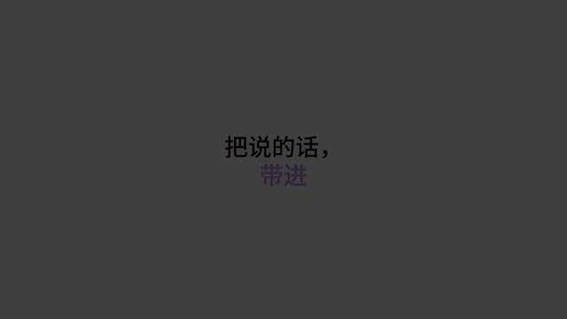

# 模板 14 · 灰色画布 + 多人光标

参考片：[Code Layers: Collaborate with code on the canvas · Figma](https://www.youtube.com/watch?v=UMDUAHmhkT8)（Figma，2026）

风格：灰色画布 · 多人光标 · 手机画板 · 等宽字墙 · 像素块收尾

## 复刻了什么

- 白底「把说的话，/ 带进」，然后左边换词、右边换画面：一个输入框（手机画板 + MosMos 浮窗）、一个网页、一段对话、一个终端。
- 一整面等宽字墙是 MosMos 的原话逐字稿，镜头拉远，字墙缩成画布上的一块。
- 灰色画布上 12 个手机画板（商品列表、宫格、详情页，商品图用 Pexels 公开授权照片），带名字的彩色光标（林清禾、周舟、李经理、MosMos）在画板之间移动；详情页里的商品描述由 MosMos 逐字写进去。
- 黑底「开口说，」（黄色）→「写进每个应用。」，然后彩色像素块拼出 `/说.tsx` 和 `写好()`，最后收成 MosMos 像素标志。

画面里的产品、文案和界面都来自 [mosmos.io](https://mosmos.io)。手机画板里的商品照片来自 Pexels（见 [ASSETS.md](ASSETS.md)）；配乐和音效用 numpy 合成。参考片只用来量时间和看运动方式，仓库里没有它的任何画面、音频或视频。

## 关键数字

| 项目 | 参考片 | 本模板 |
|---|---|---|
| 时长 | 34.88 秒 | 34.875 秒 |
| 帧率 | 24 | 24 |
| 画幅 | 1920×1080 | 1920×1080 |
| 剪辑点 | 11 个 | 11 个，时间相同（误差不超过 1 帧） |
| 速度 | 128 BPM | 128 BPM |
| 响度 | −13.3 LUFS | 约 −14 LUFS，真峰值不高于 −1.5 dBTP |

## 预览



完整版（720p）：[preview.mp4](preview.mp4)

## 怎么渲染

```bash
cd templates/_engine
npm install
scripts/fetch-fonts.sh   # 一次即可：安装 Noto Sans SC / Noto Serif SC 可变字重（OFL）
RENDER_DIR=/tmp/renders scripts/render.sh 14-figma-code-layers
python3 scripts/qa.py ../14-figma-code-layers /tmp/renders/14-figma-code-layers.mp4   # 可选：剪辑点、响度和抽帧检查
```

`render.sh` 依次运行 `timeline.py`（剪辑点和音效事件）、`audio.py`（配乐）、`master.py`（归一到 −14 LUFS、限制真峰值）、Remotion 渲染，再合成 1080p 成片，并在本目录生成 `preview.mp4` 和 `preview.gif`。中间文件写在 `build/`，不进仓库。

## 文件

- `Film.tsx`：画面
- `timeline.py` / `timeline.json`：剪辑点、动画时间、音效事件
- `audio.py`：配乐和音效
- `meta.json`：规格和参考片信息
- `analysis.md`：参考片逐镜拆解
- `ASSETS.md`：外部素材来源和许可
