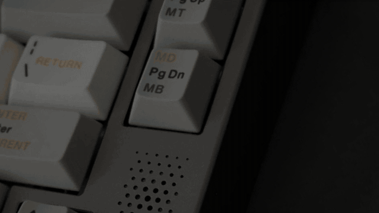

# 模板 17 · 白底产品摄影 + 细小字卡

参考片：[introducing OP–1 field](https://www.youtube.com/watch?v=Fab7sp30pg0)（teenage engineering，2022）

风格：白底产品摄影 · 键帽微距 · 细小字卡逐词替换 · 漏光收尾

## 复刻了什么

- 黑底极小的细字「从打字，回到说话。」开场。
- 键帽微距：两张 Pexels 键盘照片用 CSS 裁切、旋转、慢推，配亮度渐变和暗角，模拟参考片的产品灯光。
- 白底细字逐词替换：「按下 Fn，说话。/ 润色。/ 写好。」和「少打字，/ 少改字，/ 多说话。」。
- 复古键盘上方浮着 MosMos 浮窗；白色键盘主镜头里浮窗依次变成「语音输入 → 润色中 → 已写好」。
- 收尾：「全新的」→ 细体 MosMos 加「语音输入」标签和平台小字 → 一道强烈的线性漏光 → 黑场。

画面里的产品、文案和界面都来自 [mosmos.io](https://mosmos.io)。键盘照片来自 Pexels，按键声是 Freesound 上的 CC0 录音（见 [ASSETS.md](ASSETS.md)）；配乐用 numpy 合成。参考片只用来量时间和看运动方式，仓库里没有它的任何画面、音频或视频。

## 关键数字

| 项目 | 参考片 | 本模板 |
|---|---|---|
| 时长 | 28.1 秒 | 28.08 秒 |
| 帧率 | 25 | 25 |
| 画幅 | 1920×1080 | 1920×1080 |
| 剪辑点 | 10 个 | 10 个，时间相同（误差不超过 1 帧） |
| 速度 | 110 BPM | 110 BPM |
| 响度 | −10.7 LUFS | 约 −14 LUFS，真峰值不高于 −1.5 dBTP |

参考片是硬件产品片。本模板不编造硬件，用两张公开授权的键盘照片做「产品摄影」，MosMos 浮窗浮在键盘上方（MosMos 用 Fn 键触发）。

## 预览



完整版（720p）：[preview.mp4](preview.mp4)

## 怎么渲染

```bash
cd templates/_engine
npm install
scripts/fetch-fonts.sh   # 一次即可：安装 Noto Sans SC / Noto Serif SC 可变字重（OFL）
RENDER_DIR=/tmp/renders scripts/render.sh 17-op1-field
python3 scripts/qa.py ../17-op1-field /tmp/renders/17-op1-field.mp4   # 可选：剪辑点、响度和抽帧检查
```

`render.sh` 依次运行 `timeline.py`（剪辑点和音效事件）、`audio.py`（配乐）、`master.py`（归一到 −14 LUFS、限制真峰值）、Remotion 渲染，再合成 1080p 成片，并在本目录生成 `preview.mp4` 和 `preview.gif`。中间文件写在 `build/`，不进仓库。

## 文件

- `Film.tsx`：画面
- `timeline.py` / `timeline.json`：剪辑点、动画时间、音效事件
- `audio.py`：配乐和音效
- `meta.json`：规格和参考片信息
- `analysis.md`：参考片逐镜拆解
- `ASSETS.md`：外部素材来源和许可
