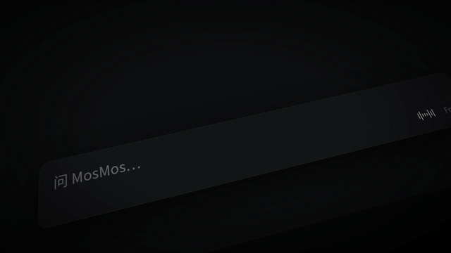

# 模板 18 · 暗色倾斜界面 + 浅景深

参考片：[Introducing Linear Agent](https://www.youtube.com/watch?v=mRql2VJ99gM)（Linear，2026）

风格：暗色倾斜界面 · 浅景深 · 低调对话 · 发光字收尾

## 复刻了什么

- 整片的界面都躺在一块倾斜的暗色平面上，镜头缓慢滑动，一条清晰带在画面里移动，其余部分虚掉，跟参考片一样。
- 开场是 MosMos 暗色窗口的侧栏和页面标题「首页改版周会」，然后底部的「问 MosMos」输入条里用语音说出「整理一下刚才的会」。
- MosMos 回复会议结论，下面一条条长出待办（带状态圆点），接着再说一句「把待办写成邮件，发给李经理」。
- 邮件页面逐字写出标题、概要和待办表；然后是一张流程图：三位说话人 → 逐字稿 → 会议总结 / 待办 → 邮件，连线逐条画出。
- 整窗全景（侧栏、邮件、右侧面板），再推到对话气泡「邮件写好了……」「还要我写什么？」。
- 黑底发光字「MosMos。开口，就写好。」从模糊里打出，最后一个小小的像素标志。

画面里的产品、文案和界面都来自 [mosmos.io](https://mosmos.io)。这个模板没有用外部照片或录音（见 [ASSETS.md](ASSETS.md)）；配乐用 numpy 合成。参考片只用来量时间和看运动方式，仓库里没有它的任何画面、音频或视频。

## 关键数字

| 项目 | 参考片 | 本模板 |
|---|---|---|
| 时长 | 54.92 秒 | 54.917 秒 |
| 帧率 | 60 | 60 |
| 画幅 | 1920×1080 | 1920×1080 |
| 剪辑点 | 7 个 | 7 个，时间相同（误差不超过 1 帧） |
| 速度 | 71 BPM | 71 BPM |
| 响度 | −28.9 LUFS | 约 −14 LUFS，真峰值不高于 −1.5 dBTP |

参考片是 2:1 画幅（1920×960），本模板按仓库统一做 1920×1080。参考片很安静（−28.9 LUFS），本模板按统一标准做到 −14 LUFS。景深用一份模糊副本加一份遮罩清晰副本，模糊半径压到 5 像素，渲染比全量景深快。

## 预览



完整版（720p）：[preview.mp4](preview.mp4)

## 怎么渲染

```bash
cd templates/_engine
npm install
scripts/fetch-fonts.sh   # 一次即可：安装 Noto Sans SC / Noto Serif SC 可变字重（OFL）
RENDER_DIR=/tmp/renders scripts/render.sh 18-linear-agent
python3 scripts/qa.py ../18-linear-agent /tmp/renders/18-linear-agent.mp4   # 可选：剪辑点、响度和抽帧检查
```

`render.sh` 依次运行 `timeline.py`（剪辑点和音效事件）、`audio.py`（配乐）、`master.py`（归一到 −14 LUFS、限制真峰值）、Remotion 渲染，再合成 1080p 成片，并在本目录生成 `preview.mp4` 和 `preview.gif`。中间文件写在 `build/`，不进仓库。

## 文件

- `Film.tsx`：画面
- `timeline.py` / `timeline.json`：剪辑点、动画时间、音效事件
- `audio.py`：配乐和音效
- `meta.json`：规格和参考片信息
- `analysis.md`：参考片逐镜拆解
- `ASSETS.md`：外部素材来源和许可
