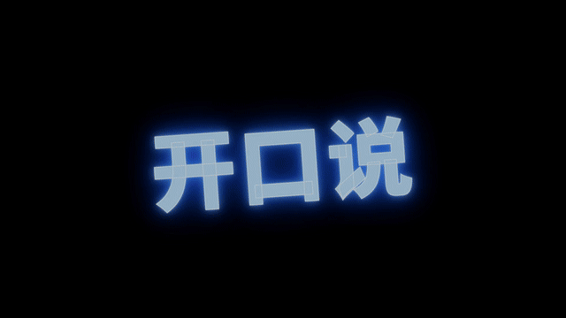

# 模板 20 · 黑底玻璃界面 + 着色器字

参考片：[Framer Update: Interactive Shaders](https://www.youtube.com/watch?v=rwMJ08sXNOA)（Framer，2026）

风格：黑底玻璃界面 · 霓虹字 · 镀铬圆环 · 彩虹玻璃字 · 属性面板 · 长时间漂浮

## 复刻了什么

- 黑底上一个半透明的玻璃工具条（MosMos ▾、输入 / 润色 / 会议标签、搜索热词框），慢慢转动。
- 三个「着色器」画面：蓝色霓虹字「开口说」，镀铬圆环里是关闭 / 标准 / 高级三档润色（环上的反射用 Poly Haven 的 CC0 摄影棚 HDRI），彩虹玻璃质感的 MosMos 字。
- 编辑器：镜头从整个窗口推到画布和右侧属性面板，鼠标依次拖动圆角、折射、模糊、色散滑块，玻璃工具条跟着变；然后打开「过渡」弹出框，调刚度和阻尼，弹簧曲线跟着变。
- 淡入黑场后，调好的玻璃工具条独自漂浮，标签在输入 / 润色 / 会议之间切换，搜索框里说出「热词：Nimbus」。
- 最后黑底上像素标志拼出来。

画面里的产品、文案和界面都来自 [mosmos.io](https://mosmos.io)。镀铬和玻璃的反射用的是 Poly Haven 的 CC0 HDRI（见 [ASSETS.md](ASSETS.md)）；其余画面是代码画的，配乐用 numpy 合成。参考片只用来量时间和看运动方式，仓库里没有它的任何画面、音频或视频。

## 关键数字

| 项目 | 参考片 | 本模板 |
|---|---|---|
| 时长 | 80.27 秒 | 80.267 秒 |
| 帧率 | 60 | 60 |
| 画幅 | 1920×1080 | 1920×1080 |
| 剪辑点 | 4 个 | 4 个，时间相同（误差不超过 1 帧） |
| 速度 | 100 BPM | 100 BPM |
| 响度 | −11.7 LUFS | 约 −14 LUFS，真峰值不高于 −1.5 dBTP |

参考片后半段（约 38–74 秒）是同一个玻璃组件在黑底上慢慢漂浮，只有很少的交互，本模板照这个节奏保留了这段长镜头。

## 预览



完整版（720p）：[preview.mp4](preview.mp4)

## 怎么渲染

```bash
cd templates/_engine
npm install
scripts/fetch-fonts.sh   # 一次即可：安装 Noto Sans SC / Noto Serif SC 可变字重（OFL）
RENDER_DIR=/tmp/renders scripts/render.sh 20-framer-shaders
python3 scripts/qa.py ../20-framer-shaders /tmp/renders/20-framer-shaders.mp4   # 可选：剪辑点、响度和抽帧检查
```

`render.sh` 依次运行 `timeline.py`（剪辑点和音效事件）、`audio.py`（配乐）、`master.py`（归一到 −14 LUFS、限制真峰值）、Remotion 渲染，再合成 1080p 成片，并在本目录生成 `preview.mp4` 和 `preview.gif`。中间文件写在 `build/`，不进仓库。

## 文件

- `Film.tsx`：画面
- `timeline.py` / `timeline.json`：剪辑点、动画时间、音效事件
- `audio.py`：配乐和音效
- `meta.json`：规格和参考片信息
- `analysis.md`：参考片逐镜拆解
- `ASSETS.md`：外部素材来源和许可
