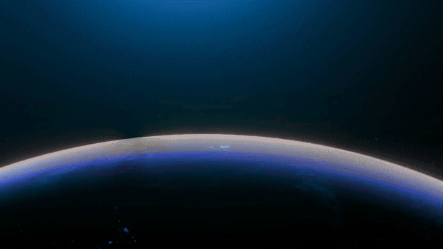

# 模板 21 · 星球地平线 + 快切任务卡

参考片：[Meet Kimi K2.6 Agent Swarm](https://www.youtube.com/watch?v=v7IJ8JNUNQ8)（Moonshot AI (Kimi)，2026）

风格：星球地平线 · 胶囊标题 · 快切任务卡 · 翻转方块墙 · 白色输入收尾

## 复刻了什么

- 星球地平线照片（Pexels 公开授权，调成蓝色）上两行标题「全新的 MosMos / 一次开口，处处写好」。
- 浅色底上白色胶囊标题一词一长：MosMos → MosMos 会议 → MosMos 会议记录 ▾。
- 提问卡片里说出「把这场周会的录音，写成纪要、待办、给李经理的邮件和群公告」，然后快切：分给 5 个场景、三档润色、八个步骤逐个打勾、「一次开口」字卡、几页成稿、彩色待办表、大字号步骤清单、一排排成稿页面。
- 一面方块墙逐个翻过来，中间一条胶囊「说一次，每一处都写好」；成稿卡片散开再拉远成一整面。
- 白色输入框里打出「MosMos，说过的都不落下。」，回到模糊的星球，像素标志和 MosMos，最后 mosmos.io。

画面里的产品、文案和界面都来自 [mosmos.io](https://mosmos.io)。星球照片来自 Pexels（见 [ASSETS.md](ASSETS.md)）；配乐和音效用 numpy 合成。参考片只用来量时间和看运动方式，仓库里没有它的任何画面、音频或视频。

## 关键数字

| 项目 | 参考片 | 本模板 |
|---|---|---|
| 时长 | 37.36 秒 | 37.367 秒 |
| 帧率 | 29.97 | 30 |
| 画幅 | 1920×1080 | 1920×1080 |
| 剪辑点 | 23 个 | 23 个，时间相同（误差不超过 1 帧） |
| 速度 | 112 BPM | 112 BPM |
| 响度 | −14.9 LUFS | 约 −14 LUFS，真峰值不高于 −1.5 dBTP |

参考片标称 29.97 fps，本模板用 30 fps。检测器还标出了第 2 帧（0.067 秒，封面帧），那不是剪辑点，没有算进去。参考片里的「300 个子智能体、4000 步」这类数字没有照搬，换成 MosMos 真实的数量：5 个场景、3 档润色。

## 预览



完整版（720p）：[preview.mp4](preview.mp4)

## 怎么渲染

```bash
cd templates/_engine
npm install
scripts/fetch-fonts.sh   # 一次即可：安装 Noto Sans SC / Noto Serif SC 可变字重（OFL）
RENDER_DIR=/tmp/renders scripts/render.sh 21-kimi-swarm
python3 scripts/qa.py ../21-kimi-swarm /tmp/renders/21-kimi-swarm.mp4   # 可选：剪辑点、响度和抽帧检查
```

`render.sh` 依次运行 `timeline.py`（剪辑点和音效事件）、`audio.py`（配乐）、`master.py`（归一到 −14 LUFS、限制真峰值）、Remotion 渲染，再合成 1080p 成片，并在本目录生成 `preview.mp4` 和 `preview.gif`。中间文件写在 `build/`，不进仓库。

## 文件

- `Film.tsx`：画面
- `timeline.py` / `timeline.json`：剪辑点、动画时间、音效事件
- `audio.py`：配乐和音效
- `meta.json`：规格和参考片信息
- `analysis.md`：参考片逐镜拆解
- `ASSETS.md`：外部素材来源和许可
