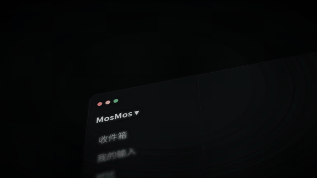

# 模板 23 · 暗色倾斜界面 + 逐行对比

参考片：[Introducing Linear Diffs](https://www.youtube.com/watch?v=7gZBxBTapDQ)（Linear，2026）

风格：暗色倾斜界面 · 浅景深 · 原话与润色的逐行对比 · 紫色确认按钮

## 复刻了什么

- 开场是 MosMos 暗色窗口侧栏的微距：三个窗口圆点、MosMos ▾、收件箱 / 我的输入 / 对比，「对比」被选中；镜头滑到一列待确认的润色（每条带新增和删除的行数）。
- 倾斜的逐行对比：红色是原话（嗯、那个、重复的话、写错的人名），绿色是润色后的句子，从下往上升起。
- 标签微距：MM-882 › 首页改版周会纪要，下面「原话 / 润色 / 对比」三个胶囊，切到「对比」。
- 左边是润色说明和文件列表，右边是红绿对比，镜头先贴着红行和绿行走，再拉远看整窗。
- 紫色「确认润色」按钮的微距；回到对比，鼠标停在一行上，旁边出现「＋」。
- 行内的语音评论：「周会纪要 · 第 45 行」后面说出「把这句的「品牌」去掉，就叫素材」，MosMos 回复只改了这一行。
- 改好的对比下面是「采用 / 确认润色」，按下后显示「已确认」；黑底字「看清每一处改动」，最后像素标志和 MosMos。

画面里的产品、文案和界面都来自 [mosmos.io](https://mosmos.io)。这个模板没有用外部照片或录音（见 [ASSETS.md](ASSETS.md)）；配乐用 numpy 合成。参考片只用来量时间和看运动方式，仓库里没有它的任何画面、音频或视频。

## 关键数字

| 项目 | 参考片 | 本模板 |
|---|---|---|
| 时长 | 51.97 秒 | 51.967 秒 |
| 帧率 | 60 | 60 |
| 画幅 | 1920×1080 | 1920×1080 |
| 剪辑点 | 7 个 | 7 个，时间相同（误差不超过 1 帧） |
| 速度 | 87 BPM | 87 BPM |
| 响度 | −13.9 LUFS | 约 −14 LUFS，真峰值不高于 −1.5 dBTP |

参考片的节拍检测在 87 和 117 BPM 之间摇摆，配乐按 87 BPM 写。景深沿用模板 18 的做法（一份模糊副本加一份遮罩清晰副本，模糊半径 5–7 像素）。

## 预览



完整版（720p）：[preview.mp4](preview.mp4)

## 怎么渲染

```bash
cd templates/_engine
npm install
scripts/fetch-fonts.sh   # 一次即可：安装 Noto Sans SC / Noto Serif SC 可变字重（OFL）
RENDER_DIR=/tmp/renders scripts/render.sh 23-linear-diffs
python3 scripts/qa.py ../23-linear-diffs /tmp/renders/23-linear-diffs.mp4   # 可选：剪辑点、响度和抽帧检查
```

`render.sh` 依次运行 `timeline.py`（剪辑点和音效事件）、`audio.py`（配乐）、`master.py`（归一到 −14 LUFS、限制真峰值）、Remotion 渲染，再合成 1080p 成片，并在本目录生成 `preview.mp4` 和 `preview.gif`。中间文件写在 `build/`，不进仓库。

## 文件

- `Film.tsx`：画面
- `timeline.py` / `timeline.json`：剪辑点、动画时间、音效事件
- `audio.py`：配乐和音效
- `meta.json`：规格和参考片信息
- `analysis.md`：参考片逐镜拆解
- `ASSETS.md`：外部素材来源和许可
