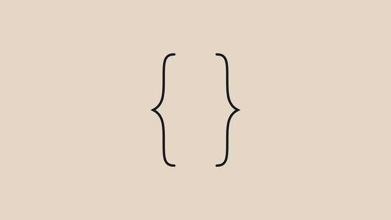

# 模板 24 · 米色底 + 团队聊天窗口

参考片：[Claude Code in Slack](https://www.youtube.com/watch?v=XpXImenrSPI)（Anthropic，2025）

风格：米色底手绘开场 · 团队聊天窗口 · 状态卡片 · 绿色按钮收尾

## 复刻了什么

- 米色底上手画的一对大括号，中间冒出一个白色对话泡，里面是声波；对话泡放大铺满画面。
- 聊天窗口：# 首页改版 里周舟问「李经理在问今天周会的纪要，下午能发出来吗？」，打开话题，在回复框里按 Fn 说话，MosMos 浮窗从「语音输入」到「润色中」再到「已写好」，原话「嗯可以，那个……」变成「可以，我现在整理，好了发到群里。」后发出。
- 大号状态卡片：MosMos · 会议记录，依次显示正在转写录音、区分说话人、整理待办、润色成纪要。
- 话题里的 MosMos 卡片「纪要写好了，结论和 3 条待办都在里面」，鼠标点「查看纪要」。
- MosMos 会议记录窗口里五个步骤逐个打勾；三个快切是逐字稿片段（绿色块，按说话人分开）。
- 纪要页面向上滚动：会议结论、待办、整理时处理了什么，底部是「复制 / 发到 # 首页改版」。
- 回到话题，纪要已经发出；绿色胶囊「✓ 已发送」弹出后落下，最后像素标志和 MosMos 字标。

画面里的产品、文案和界面都来自 [mosmos.io](https://mosmos.io)。这个模板没有用外部照片或录音（见 [ASSETS.md](ASSETS.md)）；配乐和音效用 numpy 合成。参考片只用来量时间和看运动方式，仓库里没有它的任何画面、音频或视频。

## 关键数字

| 项目 | 参考片 | 本模板 |
|---|---|---|
| 时长 | 41.1 秒 | 41.1 秒 |
| 帧率 | 30 | 30 |
| 画幅 | 1920×1080 | 1920×1080 |
| 剪辑点 | 10 个 | 10 个，时间相同（误差不超过 1 帧） |
| 速度 | 93 BPM | 93 BPM |
| 响度 | −10.8 LUFS | 约 −14 LUFS，真峰值不高于 −1.5 dBTP |

聊天窗口是一个通用的团队聊天界面，配色和图标都没有用参考片里那款聊天软件的样子。参考片里的 AI 是在聊天里被 @ 的机器人；MosMos 不是机器人，这里换成用 MosMos 语音回复话题、再用会议记录把录音整理成纪要。

## 预览



完整版（720p）：[preview.mp4](preview.mp4)

## 怎么渲染

```bash
cd templates/_engine
npm install
scripts/fetch-fonts.sh   # 一次即可：安装 Noto Sans SC / Noto Serif SC 可变字重（OFL）
RENDER_DIR=/tmp/renders scripts/render.sh 24-claude-code-slack
python3 scripts/qa.py ../24-claude-code-slack /tmp/renders/24-claude-code-slack.mp4   # 可选：剪辑点、响度和抽帧检查
```

`render.sh` 依次运行 `timeline.py`（剪辑点和音效事件）、`audio.py`（配乐）、`master.py`（归一到 −14 LUFS、限制真峰值）、Remotion 渲染，再合成 1080p 成片，并在本目录生成 `preview.mp4` 和 `preview.gif`。中间文件写在 `build/`，不进仓库。

## 文件

- `Film.tsx`：画面
- `timeline.py` / `timeline.json`：剪辑点、动画时间、音效事件
- `audio.py`：配乐和音效
- `meta.json`：规格和参考片信息
- `analysis.md`：参考片逐镜拆解
- `ASSETS.md`：外部素材来源和许可
