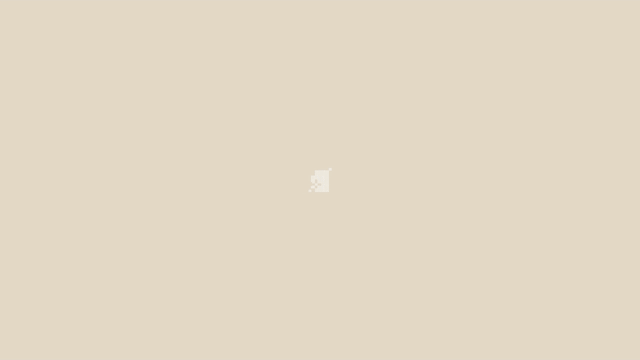

# 模板 25 · 米色底 + 一镜到底的会议记录

参考片：[Pick up where you left off with Claude](https://www.youtube.com/watch?v=UdoY2l5TZaA)（Anthropic，2025）

风格：米色底 · 一镜到底的浅色界面 · 漂浮的会议卡片收成一叠 · 形状收尾

## 复刻了什么

- 米色底上像素标志转一下，一团白色形状放大成窗口。
- 窗口首页「欢迎回来，小林」，输入框里用语音说出「我休假回来了，上周首页改版的会都聊了什么？」，发出。
- 回复「我在你的会议记录里找一下上周的内容」，下面转圈「正在查找相关的会议记录…」；镜头拉远，十几张会议记录卡片（首页改版周会、交互稿评审、品牌素材对齐……）在窗口周围漂浮，然后飞到一起叠成一摞。
- 「相关会议记录 · 3 场」列表展开又收起，回答逐字写出：结论、还没完成的待办和负责人，最后问要先看哪一场。
- 底部输入框里说出「好，先看周五那场的逐字稿。」发出；窗口缩成一团，变成像素标志和 MosMos 字标。

画面里的产品、文案和界面都来自 [mosmos.io](https://mosmos.io)。这个模板没有用外部照片或录音（见 [ASSETS.md](ASSETS.md)）；配乐用 numpy 合成。参考片只用来量时间和看运动方式，仓库里没有它的任何画面、音频或视频。

## 关键数字

| 项目 | 参考片 | 本模板 |
|---|---|---|
| 时长 | 34.69 秒 | 34.633 秒 |
| 帧率 | 30 | 30 |
| 画幅 | 1920×1080 | 1920×1080 |
| 剪辑点 | 3 个 | 3 个，时间相同（误差不超过 1 帧） |
| 速度 | 100 BPM | 100 BPM |
| 响度 | −27.4 LUFS | 约 −14 LUFS，真峰值不高于 −1.5 dBTP |

参考片在两个剪辑点之间是一整段连续镜头，本模板也一样，所有变化都靠镜头推拉和界面变形。参考片最后一帧（34.6 秒）是黑场，本模板也留了这一帧。参考片很安静（−27.4 LUFS），本模板按统一标准做到 −14 LUFS。

## 预览



完整版（720p）：[preview.mp4](preview.mp4)

## 怎么渲染

```bash
cd templates/_engine
npm install
scripts/fetch-fonts.sh   # 一次即可：安装 Noto Sans SC / Noto Serif SC 可变字重（OFL）
RENDER_DIR=/tmp/renders scripts/render.sh 25-claude-pick-up
python3 scripts/qa.py ../25-claude-pick-up /tmp/renders/25-claude-pick-up.mp4   # 可选：剪辑点、响度和抽帧检查
```

`render.sh` 依次运行 `timeline.py`（剪辑点和音效事件）、`audio.py`（配乐）、`master.py`（归一到 −14 LUFS、限制真峰值）、Remotion 渲染，再合成 1080p 成片，并在本目录生成 `preview.mp4` 和 `preview.gif`。中间文件写在 `build/`，不进仓库。

## 文件

- `Film.tsx`：画面
- `timeline.py` / `timeline.json`：剪辑点、动画时间、音效事件
- `audio.py`：配乐和音效
- `meta.json`：规格和参考片信息
- `analysis.md`：参考片逐镜拆解
- `ASSETS.md`：外部素材来源和许可
