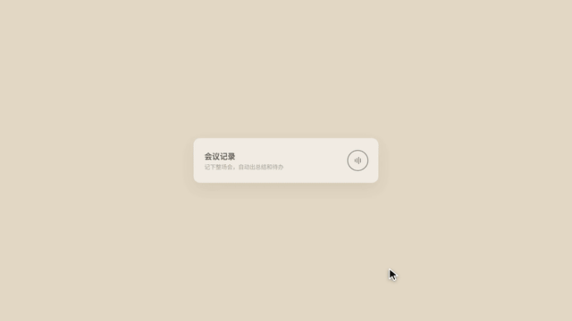

# 模板 26 · 暖灰底 + 卡片展开成分步弹窗

参考片：[Introducing Claude for Education](https://www.youtube.com/watch?v=MIzq6LCMTtA)（Anthropic，2025）

风格：暖灰底 · 卡片展开成分步弹窗 · 光标操作 · 右侧文档面板 · 收回成卡片

## 复刻了什么

- 暖灰底上一张小卡片「会议记录 · 记下整场会，自动出总结和待办」，鼠标点一下，卡片展开成弹窗。
- 第 1 步：「这场会叫什么？」输入「首页改版周会」，点「创建」。
- 第 2 步：「添加这场会的热词」，鼠标拖着林清禾、Nimbus、Figma 三张卡片进来，放下的区域变蓝；硬切后三张卡片排在框里，点「继续」。
- 弹窗变成大窗口：首页改版周会，已录 32 分钟 · 3 位说话人；右边是这场会的热词和逐字稿；镜头推近输入框，点建议按钮「会议总结」，提示词填进来，发出。
- 对话里回复逐字写出，右边滑出文档面板「首页改版周会 · 会议总结」：会议背景、关键结论、待办（带负责人）、整理时处理了什么。
- 窗口收回成开头那张小卡片。

画面里的产品、文案和界面都来自 [mosmos.io](https://mosmos.io)。这个模板没有用外部照片或录音（见 [ASSETS.md](ASSETS.md)）；配乐用 numpy 合成。参考片只用来量时间和看运动方式，仓库里没有它的任何画面、音频或视频。

## 关键数字

| 项目 | 参考片 | 本模板 |
|---|---|---|
| 时长 | 34.06 秒 | 34.067 秒 |
| 帧率 | 30 | 30 |
| 画幅 | 1920×1080 | 1920×1080 |
| 剪辑点 | 1 个 | 1 个，时间相同（误差不超过 1 帧） |
| 速度 | 90 BPM | 90 BPM |
| 响度 | −15.0 LUFS | 约 −14 LUFS，真峰值不高于 −1.5 dBTP |

参考片里的第二步是拖入课程资料；MosMos 没有导入文件做词库的功能，这里换成把三张热词卡片（人名、项目、工具）拖进来，这些都是热词功能本来就有的内容。

## 预览



完整版（720p）：[preview.mp4](preview.mp4)

## 怎么渲染

```bash
cd templates/_engine
npm install
scripts/fetch-fonts.sh   # 一次即可：安装 Noto Sans SC / Noto Serif SC 可变字重（OFL）
RENDER_DIR=/tmp/renders scripts/render.sh 26-claude-education
python3 scripts/qa.py ../26-claude-education /tmp/renders/26-claude-education.mp4   # 可选：剪辑点、响度和抽帧检查
```

`render.sh` 依次运行 `timeline.py`（剪辑点和音效事件）、`audio.py`（配乐）、`master.py`（归一到 −14 LUFS、限制真峰值）、Remotion 渲染，再合成 1080p 成片，并在本目录生成 `preview.mp4` 和 `preview.gif`。中间文件写在 `build/`，不进仓库。

## 文件

- `Film.tsx`：画面
- `timeline.py` / `timeline.json`：剪辑点、动画时间、音效事件
- `audio.py`：配乐和音效
- `meta.json`：规格和参考片信息
- `analysis.md`：参考片逐镜拆解
- `ASSETS.md`：外部素材来源和许可
