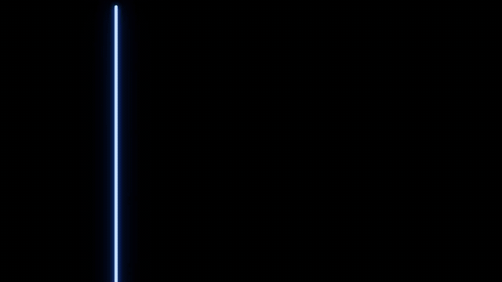

# 模板 27 · 黑底蓝色霓虹 + 光轨字卡

参考片：[Framer 3.0 with Agents, Branching, and a new Community](https://www.youtube.com/watch?v=6aioEoCdBJw)（Framer，2026）

风格：黑底蓝色霓虹光线扫出界面 · 发光按钮 · 快切功能卡 · 光轨字卡 · 霓虹标志

## 复刻了什么

- 黑底上一根蓝色霓虹竖线横扫过去，扫出 MosMos 的工具条（输入 / 会议 / 热词）和场景搜索面板（飞书 / 微信、邮件、文档、提示词、代码与终端），选中「邮件」。
- 光线变成一个发光的圆角框，再变成一颗发光的「已写好」按钮。
- 快切：工具条和面板（标准润色、已写好、新的输入）、示例网页 NIMBUS（海面照片来自 Pexels）、设置列表、手机预览。
- 在网页上用语音说「把这一页的文案改得正式一点，和上面的风格统一」；右键菜单里选「换成高级润色」；同一句话的关闭 / 标准 / 高级三个版本并排。
- 说出一段提示词，下一镜是排好的提示词，然后一圈场景卡片转起来、一团点阵球、热词用不同字重排列、一面方块图标墙，黑底字「在任何应用里，都能开口说」。
- 热词库表格（每条带近音词）慢慢上移，拉远成一整面成稿卡片墙。
- 三张光轨照片（Pexels 长曝光，调成蓝色和青色）上依次写「欢迎使用 MosMos」「开口说」「按场景润色」「会议也一起记下」「MosMos」，一道白光后是发蓝光的像素标志，标志收成一道光线，最后白色小标志淡出到黑场。

画面里的产品、文案和界面都来自 [mosmos.io](https://mosmos.io)。网页里的海面和结尾的光轨是 Pexels 公开授权照片（见 [ASSETS.md](ASSETS.md)）；其余画面是代码画的，配乐用 numpy 合成。参考片只用来量时间和看运动方式，仓库里没有它的任何画面、音频或视频。

## 关键数字

| 项目 | 参考片 | 本模板 |
|---|---|---|
| 时长 | 75.16 秒 | 75.167 秒 |
| 帧率 | 29.97 | 30 |
| 画幅 | 1920×1080 | 1920×1080 |
| 剪辑点 | 27 个 | 27 个，时间相同（误差不超过 1 帧） |
| 速度 | 120 BPM | 120 BPM |
| 响度 | −13.8 LUFS | 约 −14 LUFS，真峰值不高于 −1.5 dBTP |

参考片标称 29.97 fps，本模板用 30 fps。参考片结尾的「3.0」是它自己的版本号，这里不编造 MosMos 的版本号，收尾只写 MosMos。

## 预览



完整版（720p）：[preview.mp4](preview.mp4)

## 怎么渲染

```bash
cd templates/_engine
npm install
scripts/fetch-fonts.sh   # 一次即可：安装 Noto Sans SC / Noto Serif SC 可变字重（OFL）
RENDER_DIR=/tmp/renders scripts/render.sh 27-framer-3
python3 scripts/qa.py ../27-framer-3 /tmp/renders/27-framer-3.mp4   # 可选：剪辑点、响度和抽帧检查
```

`render.sh` 依次运行 `timeline.py`（剪辑点和音效事件）、`audio.py`（配乐）、`master.py`（归一到 −14 LUFS、限制真峰值）、Remotion 渲染，再合成 1080p 成片，并在本目录生成 `preview.mp4` 和 `preview.gif`。中间文件写在 `build/`，不进仓库。

## 文件

- `Film.tsx`：画面
- `timeline.py` / `timeline.json`：剪辑点、动画时间、音效事件
- `audio.py`：配乐和音效
- `meta.json`：规格和参考片信息
- `analysis.md`：参考片逐镜拆解
- `ASSETS.md`：外部素材来源和许可
