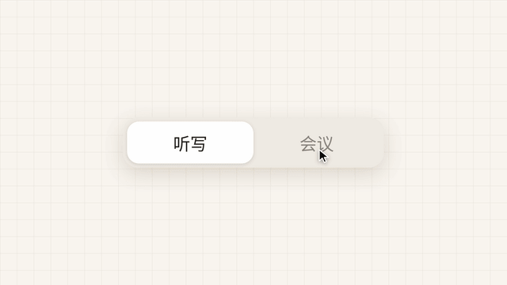

# 模板 29 · 浅色网格底 + 一个键记下整场会

参考片：[Introducing Cowork: Claude Code for the rest of your work](https://www.youtube.com/watch?v=UAmKyyZ-b9E)（Anthropic，2026）

风格：浅色网格底 · 切换开关化成标志 · 任务卡片 · 问答卡和进度卡 · 衬线字收尾

## 复刻了什么

- 米色底上一行衬线字「一个键，记下整场会」。
- 网格底上「听写 | 会议」切换开关放大，然后化成像素标志。
- 大标题「今天，先把哪件事说完？」和六张任务卡片；在输入框里用语音说出要做的事。
- 弹出会议记录选择框，选中一场；推近输入框，点「开始整理 →」。
- 问答卡：「总结和待办 / 只要待办 / 完整逐字稿」，选第一项。
- 「正在整理…」和进度卡片，步骤逐个打勾；中间插入三条说话气泡。
- 会议记录窗口、相关内容列表、「生成内容」卡片，再拉远成一个宽窗口，三个统计块只写本片里的虚构数字（3 位说话人、3 条待办等）。
- 回复框特写，最后衬线字「下一场会，开口就好」和像素标志。

画面里的产品、文案和界面都来自 [mosmos.io](https://mosmos.io)。这个模板没有用外部照片或录音（见 [ASSETS.md](ASSETS.md)）；配乐和音效用 numpy 合成。参考片只用来量时间和看运动方式，仓库里没有它的任何画面、音频或视频。

## 关键数字

| 项目 | 参考片 | 本模板 |
|---|---|---|
| 时长 | 68.64 秒 | 68.625 秒 |
| 帧率 | 24 | 24 |
| 画幅 | 1920×1080 | 1920×1080 |
| 剪辑点 | 13 个 | 13 个，时间相同（误差不超过 1 帧） |
| 速度 | 110 BPM | 110 BPM |
| 响度 | −32.3 LUFS | 约 −14 LUFS，真峰值不高于 −1.5 dBTP |

参考片是一款桌面助手代人做事；MosMos 只做语音输入和会议记录，这里换成「把一场会整理成总结和待办」。参考片很安静（−32.3 LUFS），本模板按统一标准做到 −14 LUFS。

## 预览



完整版（720p）：[preview.mp4](preview.mp4)

## 怎么渲染

```bash
cd templates/_engine
npm install
scripts/fetch-fonts.sh   # 一次即可：安装 Noto Sans SC / Noto Serif SC 可变字重（OFL）
RENDER_DIR=/tmp/renders scripts/render.sh 29-claude-cowork
python3 scripts/qa.py ../29-claude-cowork /tmp/renders/29-claude-cowork.mp4   # 可选：剪辑点、响度和抽帧检查
```

`render.sh` 依次运行 `timeline.py`（剪辑点和音效事件）、`audio.py`（配乐）、`master.py`（归一到 −14 LUFS、限制真峰值）、Remotion 渲染，再合成 1080p 成片，并在本目录生成 `preview.mp4` 和 `preview.gif`。中间文件写在 `build/`，不进仓库。

## 文件

- `Film.tsx`：画面
- `timeline.py` / `timeline.json`：剪辑点、动画时间、音效事件
- `audio.py`：配乐和音效
- `meta.json`：规格和参考片信息
- `analysis.md`：参考片逐镜拆解
- `ASSETS.md`：外部素材来源和许可
