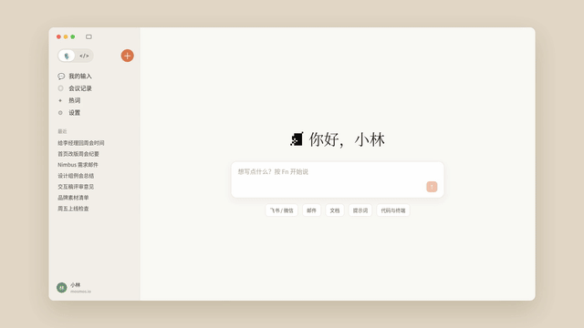

# 模板 30 · 米色底 + 桌面窗口一镜到底

参考片：[Claude Code on desktop](https://www.youtube.com/watch?v=zrcCS9oHjtI)（Anthropic，2025）

风格：米色底 · 浅色桌面窗口一镜到底 · 推近切换模式 · 擦除到衬线字卡 · 像素标志收尾

## 复刻了什么

- 米色底上的桌面窗口，首页写着「你好，小林」。
- 镜头推近侧栏的切换按钮（🎙 / </>），点下去有一圈光。
- 代码面板打开，路径 ~/order-service，场景下拉框里选「代码与终端」。
- 用语音说出要找的东西，MosMos 把它写成终端命令 `rg -l "API_KEY" .`，提示「已粘贴到终端」。
- 擦除到衬线字「代码与终端里，也一样开口说」，最后像素标志和 MosMos 字标。

画面里的产品、文案和界面都来自 [mosmos.io](https://mosmos.io)。这个模板没有用外部照片或录音（见 [ASSETS.md](ASSETS.md)）；配乐和音效用 numpy 合成。参考片只用来量时间和看运动方式，仓库里没有它的任何画面、音频或视频。

## 关键数字

| 项目 | 参考片 | 本模板 |
|---|---|---|
| 时长 | 20.39 秒 | 20.367 秒 |
| 帧率 | 30 | 30 |
| 画幅 | 1920×1080 | 1920×1080 |
| 剪辑点 | 0 个 | 0 个 |
| 速度 | 90 BPM | 90 BPM |
| 响度 | −28.8 LUFS | 约 −14 LUFS，真峰值不高于 −1.5 dBTP |

参考片没有硬切，本模板也没有，所有变化都靠镜头推拉和一次擦除。参考片很安静（−28.8 LUFS），本模板按统一标准做到 −14 LUFS。

## 预览



完整版（720p）：[preview.mp4](preview.mp4)

## 怎么渲染

```bash
cd templates/_engine
npm install
scripts/fetch-fonts.sh   # 一次即可：安装 Noto Sans SC / Noto Serif SC 可变字重（OFL）
RENDER_DIR=/tmp/renders scripts/render.sh 30-claude-code-desktop
python3 scripts/qa.py ../30-claude-code-desktop /tmp/renders/30-claude-code-desktop.mp4   # 可选：剪辑点、响度和抽帧检查
```

`render.sh` 依次运行 `timeline.py`（剪辑点和音效事件）、`audio.py`（配乐）、`master.py`（归一到 −14 LUFS、限制真峰值）、Remotion 渲染，再合成 1080p 成片，并在本目录生成 `preview.mp4` 和 `preview.gif`。中间文件写在 `build/`，不进仓库。

## 文件

- `Film.tsx`：画面
- `timeline.py` / `timeline.json`：剪辑点、动画时间、音效事件
- `audio.py`：配乐和音效
- `meta.json`：规格和参考片信息
- `analysis.md`：参考片逐镜拆解
- `ASSETS.md`：外部素材来源和许可
