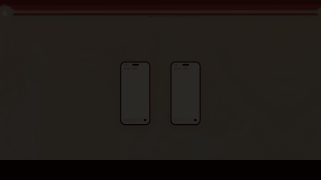

# 模板 35 · 暖光舞台上的手机 + 分得清每个说话人

参考片：[GPT-Live-1.1 has new voices and better accents.](https://www.youtube.com/watch?v=GyO8Ao7yKJc)（OpenAI，2026）

风格：暖光大理石墙前的两部手机 · 换色的声音球 · 字幕式逐字稿 · 横移找到第三部手机 · 白底打字收尾

## 复刻了什么

- 暖光大理石墙、木线条和灯泡、深红地面组成的舞台，两侧有帷幕。
- 两部手机：左边是声音球，颜色随说话人变化，下面写「说话人 N」；右边是逐字稿，每条前面一个对应颜色的圆点。
- 底部字幕是一段中文点名对话，一句一句出现。
- 镜头横移找到第三部手机，再推近约 1.22 倍。
- 白底打字「谁说了哪句，都分得清。」和功能说明，接着「MosMos 会议记录」、像素标志、字标和「mosmos.io · macOS · Windows · iOS 即将上线」。

画面里的产品、文案和界面都来自 [mosmos.io](https://mosmos.io)。除了一张 Pexels 大理石照片（见 [ASSETS.md](ASSETS.md)），画面都是代码画的；配乐和音效用 numpy 合成。参考片只用来量时间和看运动方式，仓库里没有它的任何画面、音频或视频。

## 关键数字

| 项目 | 参考片 | 本模板 |
|---|---|---|
| 时长 | 40.8 秒 | 40.8 秒 |
| 帧率 | 30 | 30 |
| 画幅 | 1920×1080 | 1920×1080 |
| 剪辑点 | 1 个 | 1 个，时间相同（误差不超过 1 帧） |
| 速度 | 100 BPM | 100 BPM |
| 响度 | −18.9 LUFS | 约 −14 LUFS，真峰值不高于 −1.5 dBTP |

参考片展示的是新的语音音色；MosMos 不做语音合成，这里换成会议记录的「区分不同发言人」：声音球换颜色代表换了说话人，旁边手机上的逐字稿按说话人标颜色。参考片的大理石墙换成 Pexels 的大理石照片（见 ASSETS.md）。手机上是 MosMos 界面，片尾写明 iOS 即将上线。

## 预览



完整版（720p）：[preview.mp4](preview.mp4)

## 怎么渲染

```bash
cd templates/_engine
npm install
scripts/fetch-fonts.sh   # 一次即可：安装 Noto Sans SC / Noto Serif SC 可变字重（OFL）
RENDER_DIR=/tmp/renders scripts/render.sh 35-openai-live-voices
python3 scripts/qa.py ../35-openai-live-voices /tmp/renders/35-openai-live-voices.mp4   # 可选：剪辑点、响度和抽帧检查
```

`render.sh` 依次运行 `timeline.py`（剪辑点和音效事件）、`audio.py`（配乐）、`master.py`（归一到 −14 LUFS、限制真峰值）、Remotion 渲染，再合成 1080p 成片，并在本目录生成 `preview.mp4` 和 `preview.gif`。中间文件写在 `build/`，不进仓库。

## 文件

- `Film.tsx`：画面
- `timeline.py` / `timeline.json`：剪辑点、动画时间、音效事件
- `audio.py`：配乐和音效
- `meta.json`：规格和参考片信息
- `analysis.md`：参考片逐镜拆解
- `ASSETS.md`：外部素材来源和许可
