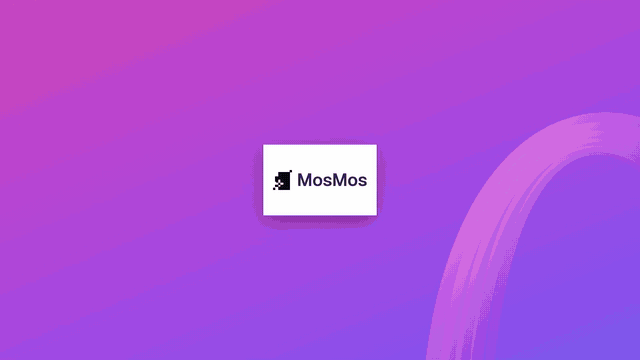

# 模板 36 · 深紫渐变大字 + 热词、润色、场景和会议卡片

参考片：[Stripe Sessions 2024 | New Revenue and Finance Automation tools](https://www.youtube.com/watch?v=CXrfVtUC8M0)（Stripe，2024）

风格：深紫藏青底 · 紫粉橙渐变光 · 一句一镜的渐变大字 · 发光的毛玻璃界面卡片 · 光标操作 · 白色标志卡收尾

## 复刻了什么

- 藏青底上暗着的标志卡，切到紫色渐变和丝带上的白色标志卡。
- 白底大号渐变字「开口说」滑入，换成「就能写好」。
- 品红渐变底上竖排滚动的功能名，橙粉渐变底「语音输入与润色」。
- 「介绍」→ 渐变字「场景润色」。
- 白底「新建热词」表单（写法 Nimbus、容易听成 尼姆布斯、类别），光标点「添加热词」；右边深色面板逐条打出我的热词。
- 「说一次」「就记住」「下次直接写对」，然后热词校正卡片：错字逐个翻成正确写法，卡片展开出对照列表。
- 「调整」「润色程度」「按你的习惯」，润色卡片里加一档、点保存。
- 「按场景换一种写法」，场景下拉框展开选「邮件」，再选风格；当前应用、怎么选场景，汇总卡片点保存。
- 「开会时」「按 Fn + Shift」，点「开始会议记录」，弹出多人逐字稿和会议总结两张卡片，再连出待办事项。
- 「接着整理」「总结和待办」，待办面板逐行标上「已整理」；「MosMos 会议记录」，白底「现在，开口就好」，最后渐变底上的标志卡。

画面里的产品、文案和界面都来自 [mosmos.io](https://mosmos.io)。这个模板没有用外部照片或录音（见 [ASSETS.md](ASSETS.md)）；配乐和音效用 numpy 合成。参考片只用来量时间和看运动方式，仓库里没有它的任何画面、音频或视频。

## 关键数字

| 项目 | 参考片 | 本模板 |
|---|---|---|
| 时长 | 66.97 秒 | 66.967 秒 |
| 帧率 | 30 | 30 |
| 画幅 | 1920×1080 | 1920×1080 |
| 剪辑点 | 25 个 | 25 个，时间相同（误差不超过 1 帧） |
| 速度 | 90 BPM | 90 BPM |
| 响度 | −11.0 LUFS | 约 −14 LUFS，真峰值不高于 −1.5 dBTP |

参考片是发布会上一组财务产品的介绍；这里把每个产品段落换成 MosMos 的一项功能：热词、润色程度、场景、会议记录的总结和待办。参考片里的数字仪表盘没有对应的产品数据，所以换成热词校正前后的对比，不编数字。

## 预览



完整版（720p）：[preview.mp4](preview.mp4)

## 怎么渲染

```bash
cd templates/_engine
npm install
scripts/fetch-fonts.sh   # 一次即可：安装 Noto Sans SC / Noto Serif SC 可变字重（OFL）
RENDER_DIR=/tmp/renders scripts/render.sh 36-stripe-sessions
python3 scripts/qa.py ../36-stripe-sessions /tmp/renders/36-stripe-sessions.mp4   # 可选：剪辑点、响度和抽帧检查
```

`render.sh` 依次运行 `timeline.py`（剪辑点和音效事件）、`audio.py`（配乐）、`master.py`（归一到 −14 LUFS、限制真峰值）、Remotion 渲染，再合成 1080p 成片，并在本目录生成 `preview.mp4` 和 `preview.gif`。中间文件写在 `build/`，不进仓库。

## 文件

- `Film.tsx`：画面
- `timeline.py` / `timeline.json`：剪辑点、动画时间、音效事件
- `audio.py`：配乐和音效
- `meta.json`：规格和参考片信息
- `analysis.md`：参考片逐镜拆解
- `ASSETS.md`：外部素材来源和许可
