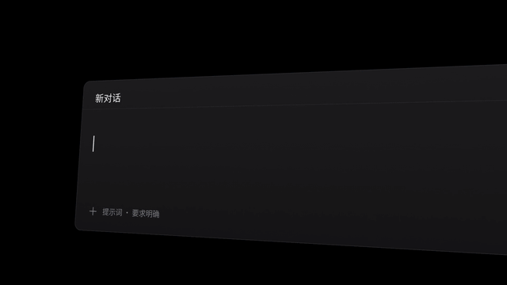

# 模板 37 · 黑底倾斜输入框 + 提示词场景

参考片：[Introducing Skills](https://www.youtube.com/watch?v=ibUWeTP2tzc)（Framer，2026）

风格：纯黑底 · 倾斜的深色输入框里逐字出现的提示词 · 宏距离大字 · 倾斜画布上成片的文稿缩略图与蓝色辉光 · 发光的场景标签 · 标志收尾

## 复刻了什么

- 黑底上倾斜的深色输入框「新对话」，说出的要求逐字出现：「输出要求：使用表格呈现差异，并给出 3 条」。
- 镜头越推越近，最后是宏距离的大字「改进建议。」。
- 倾斜的画布上一大片写好的文稿缩略图（邮件、文档、聊天、提示词、待办、终端命令），几张亮起蓝色辉光；推近一张，再横移。
- 黑底中间的输入框，逐字出现「请对比分析三款语音输入产品，」；推近后接着写「用表格呈现差异」，末尾出现蓝色的「提示词」标签。
- 画布再出现一次。
- 黑底上蓝色小字逐个闪过：五个场景和「会议记录」。
- 输入框特写里打出「提示词」，切到一枚发光的「提示词」标签，最后白色像素标志。

画面里的产品、文案和界面都来自 [mosmos.io](https://mosmos.io)。这个模板没有用外部照片或录音（见 [ASSETS.md](ASSETS.md)）；配乐和音效用 numpy 合成。参考片只用来量时间和看运动方式，仓库里没有它的任何画面、音频或视频。

## 关键数字

| 项目 | 参考片 | 本模板 |
|---|---|---|
| 时长 | 30.07 秒 | 30.067 秒 |
| 帧率 | 29.97 | 30 |
| 画幅 | 1920×1080 | 1920×1080 |
| 剪辑点 | 11 个 | 11 个，时间相同（误差不超过 1 帧） |
| 速度 | 104 BPM | 104 BPM |
| 响度 | −13.7 LUFS | 约 −14 LUFS，真峰值不高于 −1.5 dBTP |

参考片标称 29.97 fps，本模板用 30 fps。参考片的「技能」是可以用斜杠调用的设计规则；MosMos 没有斜杠命令，这里换成「提示词」场景：说出来的要求被写成清楚的提示词，结尾发光的标签是场景名。27.75 秒切到标志是一次淡出淡入，不算剪辑点。

## 预览



完整版（720p）：[preview.mp4](preview.mp4)

## 怎么渲染

```bash
cd templates/_engine
npm install
scripts/fetch-fonts.sh   # 一次即可：安装 Noto Sans SC / Noto Serif SC 可变字重（OFL）
RENDER_DIR=/tmp/renders scripts/render.sh 37-framer-skills
python3 scripts/qa.py ../37-framer-skills /tmp/renders/37-framer-skills.mp4   # 可选：剪辑点、响度和抽帧检查
```

`render.sh` 依次运行 `timeline.py`（剪辑点和音效事件）、`audio.py`（配乐）、`master.py`（归一到 −14 LUFS、限制真峰值）、Remotion 渲染，再合成 1080p 成片，并在本目录生成 `preview.mp4` 和 `preview.gif`。中间文件写在 `build/`，不进仓库。

## 文件

- `Film.tsx`：画面
- `timeline.py` / `timeline.json`：剪辑点、动画时间、音效事件
- `audio.py`：配乐和音效
- `meta.json`：规格和参考片信息
- `analysis.md`：参考片逐镜拆解
- `ASSETS.md`：外部素材来源和许可
