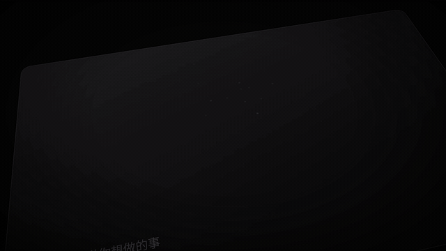

# 模板 38 · 近黑底倾斜面板 + 代码与终端场景

参考片：[Introducing Code Intelligence](https://www.youtube.com/watch?v=eKDf7I0TYpg)（Linear，2026）

风格：近黑底 · 倾斜的深色面板和点阵标志 · 斜体逐字输入 · 模糊代码前浮动的像素风对话框 · 等宽字标签 · 对话窗里的提问 · 白字和标志收尾

## 复刻了什么

- 近黑底上倾斜的深色面板，点阵标志和「MosMos 代码与终端场景，现在就能用」。
- 宽输入框里斜体逐字出现「在当前项目里查找包含 API_KEY 的文件」。
- 模糊代码前浮起像素风对话卡：「听到」→「代码与终端？是 / 否」→「命令已生成 `rg -l "API_KEY" .` 已粘贴到终端」。
- 「写进终端的是：」和 rg / -l / "API_KEY" / . 四个等宽字标签，然后倾斜的结果面板。
- 「终端里，也能开口说」，小对话窗「MosMos · 代码与终端」里轮流出现三条口述需求和对应命令。
- 「说出需求，写成命令」，最后像素标志和 MosMos 字标。

画面里的产品、文案和界面都来自 [mosmos.io](https://mosmos.io)。这个模板没有用外部照片或录音（见 [ASSETS.md](ASSETS.md)）；配乐和音效用 numpy 合成。参考片只用来量时间和看运动方式，仓库里没有它的任何画面、音频或视频。

## 关键数字

| 项目 | 参考片 | 本模板 |
|---|---|---|
| 时长 | 33.88 秒 | 33.867 秒 |
| 帧率 | 60 | 60 |
| 画幅 | 1920×1080 | 1920×1080 |
| 剪辑点 | 3 个 | 3 个，时间相同（误差不超过 1 帧） |
| 速度 | 120 BPM | 120 BPM |
| 响度 | −16.0 LUFS | 约 −14 LUFS，真峰值不高于 −1.5 dBTP |

参考片是 60 fps，本模板也按 60 fps 渲染 1080p 成片；仓库里的 preview.mp4 是 720p、30 fps 的预览。参考片介绍的是读懂代码库的问答功能；MosMos 没有代码问答，这里换成「代码与终端」场景：说出需求，写进终端的是一条命令。片中的命令都是示例。

## 预览



完整版（720p）：[preview.mp4](preview.mp4)

## 怎么渲染

```bash
cd templates/_engine
npm install
scripts/fetch-fonts.sh   # 一次即可：安装 Noto Sans SC / Noto Serif SC 可变字重（OFL）
RENDER_DIR=/tmp/renders scripts/render.sh 38-linear-code-intelligence
python3 scripts/qa.py ../38-linear-code-intelligence /tmp/renders/38-linear-code-intelligence.mp4   # 可选：剪辑点、响度和抽帧检查
```

`render.sh` 依次运行 `timeline.py`（剪辑点和音效事件）、`audio.py`（配乐）、`master.py`（归一到 −14 LUFS、限制真峰值）、Remotion 渲染，再合成 1080p 成片，并在本目录生成 `preview.mp4` 和 `preview.gif`。中间文件写在 `build/`，不进仓库。

## 文件

- `Film.tsx`：画面
- `timeline.py` / `timeline.json`：剪辑点、动画时间、音效事件
- `audio.py`：配乐和音效
- `meta.json`：规格和参考片信息
- `analysis.md`：参考片逐镜拆解
- `ASSETS.md`：外部素材来源和许可
