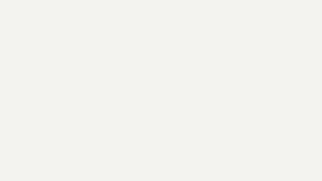

# 模板 40 · 米白纸面手绘风 + 场景、润色和会议记录

参考片：[Meet Custom Agents: Your 24/7 AI Team](https://www.youtube.com/watch?v=yrEic418kjg)（Notion，2026）

风格：米白底 · 传送带上的任务标签 · 排线手绘的手 · 粗描边的圆形图标 · 大号黑字 · 看板和列表界面 · 深蓝夜景里飞过的图标 · 按钮和标志收尾

## 复刻了什么

- 米白底上的传送带运来一串「要打的字」标签（消息、邮件、周报……），堆成一堆，打上「要打的字」徽章。
- 大字「再见，打字。」
- MosMos 窗口，场景侧栏里光标选中「邮件」。
- 排线手绘的手放下粗描边的圆形场景图标，「你好，MosMos 场景。」
- 「你在哪里说，/ 决定我们怎么写。」，「自动识别场景」，通知卡片显示当前应用和选中的场景。
- 看板「原话 / 润色中 / 成稿」。
- 「会议里，谁说了什么」，按说话人着色的逐字稿列表滚动，一条被标上「已整理进待办」。
- 「会后，总结和待办都写好了」，会议记录表格、会议总结页，然后「待办 @今天」。
- 「从早上的第一条消息……」，深蓝底「……到晚上的最后一封邮件。」，夜色里飞过的场景图标和标签（8 个镜头）。
- 按钮「＋ 下载 MosMos」被点下，最后像素标志和字标。

画面里的产品、文案和界面都来自 [mosmos.io](https://mosmos.io)。这个模板没有用外部照片或录音（见 [ASSETS.md](ASSETS.md)）；配乐和音效用 numpy 合成。参考片只用来量时间和看运动方式，仓库里没有它的任何画面、音频或视频。

## 关键数字

| 项目 | 参考片 | 本模板 |
|---|---|---|
| 时长 | 70.91 秒 | 70.9 秒 |
| 帧率 | 30 | 30 |
| 画幅 | 1920×1080 | 1920×1080 |
| 剪辑点 | 29 个 | 29 个，时间相同（误差不超过 1 帧） |
| 速度 | 115 BPM | 115 BPM |
| 响度 | −13.6 LUFS | 约 −14 LUFS，真峰值不高于 −1.5 dBTP |

参考片介绍的是能自动干活的 AI 代理；MosMos 不做代理，这里换成它真实有的功能：自动识别场景、润色、会议记录的逐字稿、总结和待办。片中的会议、人名和待办都是示例内容。

## 预览



完整版（720p）：[preview.mp4](preview.mp4)

## 怎么渲染

```bash
cd templates/_engine
npm install
scripts/fetch-fonts.sh   # 一次即可：安装 Noto Sans SC / Noto Serif SC 可变字重（OFL）
RENDER_DIR=/tmp/renders scripts/render.sh 40-notion-custom-agents
python3 scripts/qa.py ../40-notion-custom-agents /tmp/renders/40-notion-custom-agents.mp4   # 可选：剪辑点、响度和抽帧检查
```

`render.sh` 依次运行 `timeline.py`（剪辑点和音效事件）、`audio.py`（配乐）、`master.py`（归一到 −14 LUFS、限制真峰值）、Remotion 渲染，再合成 1080p 成片，并在本目录生成 `preview.mp4` 和 `preview.gif`。中间文件写在 `build/`，不进仓库。

## 文件

- `Film.tsx`：画面
- `timeline.py` / `timeline.json`：剪辑点、动画时间、音效事件
- `audio.py`：配乐和音效
- `meta.json`：规格和参考片信息
- `analysis.md`：参考片逐镜拆解
- `ASSETS.md`：外部素材来源和许可
