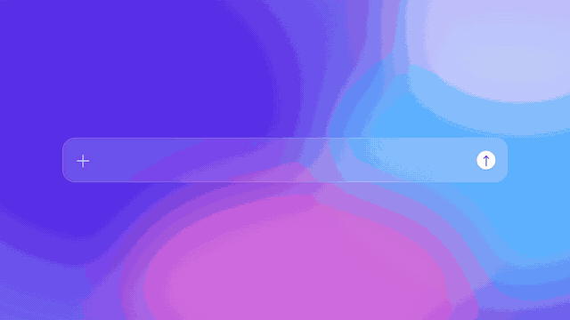

# 模板 41 · 紫蓝渐变 + 提示词、润色、热词和邮件场景

参考片：[Introducing Pitch AI actions](https://www.youtube.com/watch?v=7Nab49BybXU)（Pitch，2025）

风格：紫蓝粉渐变底 · 半透明输入条 · 黑底大字卡和描边字框 · 风景照片 · 米色幻灯片和黄色光晕 · 动作菜单 · 进度胶囊 · 3D 形状上的标志

## 复刻了什么

- 紫蓝粉渐变底上的半透明输入条，逐字出现「谁都可以开口说」，光标点发送。
- 黑底「但不是每句话，都能直接用。」，镜头推近。
- 雪山照片下描边字框「能直接用的 —— 文字 / 应该」，接着三张字卡：橙色圆点和衬线大字「通顺」、复古窗口里的「像你写的」、故障效果球体旁的「也合场景」。
- 输入条里口述一句需求，按发送后变成写好的提示词；渐变底上出现幻灯片窗口和 MosMos 菜单（全部 / 场景 / 润色 / 热词）。
- 菜单特写选「润色：高级」，黑底 Fn 键前的胶囊「正在加入热词：Nimbus」→「已加入热词：Nimbus」。
- 带黄色光晕的幻灯片（Fn 键、像素标志、声波三栏），菜单选「加入热词…」，宏距离推近再拉远。
- 米色幻灯片和菜单，输入「改成写给客户看的版本」，胶囊「MosMos 正在润色…」→「✓ 已写好」，幻灯片变成写给客户的邮件文字。
- 邮件弹窗（邮件 · 正式）点保存，接着 MosMos 的场景设置页。
- 紫色等宽字幻灯片和菜单，场景胶囊「MosMos 正在按场景润色…」，「从语音输入，到会议总结和待办。」
- 渐变底小输入条「不只是听写」，最后 3D 形状上的像素标志和字标。

画面里的产品、文案和界面都来自 [mosmos.io](https://mosmos.io)。除了一张 Pexels 雪山照片（见 [ASSETS.md](ASSETS.md)），画面都是代码画的；配乐和音效用 numpy 合成。参考片只用来量时间和看运动方式，仓库里没有它的任何画面、音频或视频。

## 关键数字

| 项目 | 参考片 | 本模板 |
|---|---|---|
| 时长 | 79.06 秒 | 79.042 秒 |
| 帧率 | 24 | 24 |
| 画幅 | 1920×1080 | 1920×1080 |
| 剪辑点 | 26 个 | 26 个，时间相同（误差不超过 1 帧） |
| 速度 | 94 BPM | 94 BPM |
| 响度 | −15.0 LUFS | 约 −14 LUFS，真峰值不高于 −1.5 dBTP |

参考片是幻灯片软件的 AI 动作；MosMos 不做幻灯片，这里把每个「动作」换成它真实有的功能：提示词场景、润色三档、热词、邮件场景。幻灯片只是承载文字的画面。参考片的风景照换成 Pexels 的雪山照片（见 ASSETS.md）。片中 65.4、75.2、77.25 秒的变化在参考片里是镜头内过渡，这里用 1 秒溶解，不算剪辑点。

## 预览



完整版（720p）：[preview.mp4](preview.mp4)

## 怎么渲染

```bash
cd templates/_engine
npm install
scripts/fetch-fonts.sh   # 一次即可：安装 Noto Sans SC / Noto Serif SC 可变字重（OFL）
RENDER_DIR=/tmp/renders scripts/render.sh 41-pitch-ai-actions
python3 scripts/qa.py ../41-pitch-ai-actions /tmp/renders/41-pitch-ai-actions.mp4   # 可选：剪辑点、响度和抽帧检查
```

`render.sh` 依次运行 `timeline.py`（剪辑点和音效事件）、`audio.py`（配乐）、`master.py`（归一到 −14 LUFS、限制真峰值）、Remotion 渲染，再合成 1080p 成片，并在本目录生成 `preview.mp4` 和 `preview.gif`。中间文件写在 `build/`，不进仓库。

## 文件

- `Film.tsx`：画面
- `timeline.py` / `timeline.json`：剪辑点、动画时间、音效事件
- `audio.py`：配乐和音效
- `meta.json`：规格和参考片信息
- `analysis.md`：参考片逐镜拆解
- `ASSETS.md`：外部素材来源和许可
