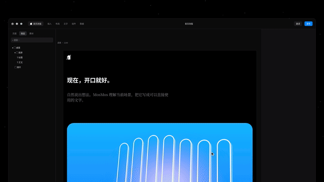

# 模板 42 · 星空前的暗色编辑器 + 悬停预览场景和润色

参考片：[Framer Update: Instant Font Previews](https://www.youtube.com/watch?v=JAKF3RTbgek)（Framer，2026）

风格：星空背景上的深色编辑器 · 选中标题后推近属性面板 · 悬停场景/润色选项时标题实时预览 · 渐黑后黑底逐词快闪 · 像素标志收尾

## 复刻了什么

- 星空背景上的暗色编辑器窗口：图层、画布和属性面板；画布上是标题「现在，开口就好。」、一段说明和一张蓝色渐变图（白色描边的声波条）。
- 光标选中标题，属性面板出现，镜头推近到画布和面板（约 1.3 倍，画布同时放大）。
- 点开「场景」，弹出 MosMos 选项面板；筛选菜单从「全部」换到「场景」。
- 光标逐个悬停 自动识别 / 飞书 / 微信 / 邮件 / 文档 / 提示词 / 代码与终端，标题随之换成对应场景写好的句子和字体。
- 筛选换到「润色」，悬停 关闭 / 标准 / 高级，标题依次显示原话、标准稿、高级稿，最后选中「高级」。
- 镜头拉回整窗，渐黑。
- 黑底中间每半秒换一个词、一种字体（开口、MosMos、消息、邮件、说完就写好、文档、Fn、提示词……），循环两遍，最后像素标志。

画面里的产品、文案和界面都来自 [mosmos.io](https://mosmos.io)。这个模板没有用外部照片或录音（见 [ASSETS.md](ASSETS.md)）；配乐和音效用 numpy 合成。参考片只用来量时间和看运动方式，仓库里没有它的任何画面、音频或视频。

## 关键数字

| 项目 | 参考片 | 本模板 |
|---|---|---|
| 时长 | 68.68 秒 | 68.683 秒 |
| 帧率 | 60 | 60 |
| 画幅 | 1920×1080 | 1920×1080 |
| 剪辑点 | 0 个（一镜到底） | 0 个（一镜到底） |
| 速度 | 105 BPM | 105 BPM |
| 响度 | −11.4 LUFS | 约 −14 LUFS，真峰值不高于 −1.5 dBTP |

参考片是 60 fps，本模板也按 60 fps 渲染 1080p 成片；仓库里的 preview.mp4 是 720p、30 fps 的预览。参考片是悬停字体时标题即时预览；这里换成悬停 MosMos 的场景和润色选项时，标题即时换成对应写法。编辑器是代码画的通用界面，不是任何真实软件。片中的文字都来自 mosmos.io 的示例。

## 预览



完整版（720p）：[preview.mp4](preview.mp4)

## 怎么渲染

```bash
cd templates/_engine
npm install
scripts/fetch-fonts.sh   # 一次即可：安装 Noto Sans SC / Noto Serif SC 可变字重（OFL）
RENDER_DIR=/tmp/renders scripts/render.sh 42-framer-font-previews
python3 scripts/qa.py ../42-framer-font-previews /tmp/renders/42-framer-font-previews.mp4   # 可选：剪辑点、响度和抽帧检查
```

`render.sh` 依次运行 `timeline.py`（剪辑点和音效事件）、`audio.py`（配乐）、`master.py`（归一到 −14 LUFS、限制真峰值）、Remotion 渲染，再合成 1080p 成片，并在本目录生成 `preview.mp4` 和 `preview.gif`。中间文件写在 `build/`，不进仓库。

## 文件

- `Film.tsx`：画面
- `timeline.py` / `timeline.json`：剪辑点、动画时间、音效事件
- `audio.py`：配乐和音效
- `meta.json`：规格和参考片信息
- `analysis.md`：参考片逐镜拆解
- `ASSETS.md`：外部素材来源和许可
