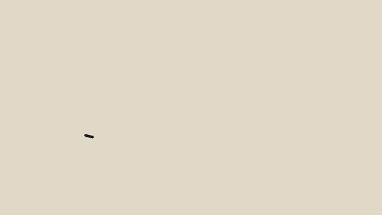

# 模板 43 · 暖米色对话窗口 + 回复里展开的场景、待办和邮件卡片

参考片：[Your tools are now interactive in Claude](https://www.youtube.com/watch?v=bluAmTHoEow)（Anthropic，2026）

风格：暖米色纸片图形开场 · 奶白对话窗口 · 推近输入框 · 回复里展开的交互卡片（流程图、场景、待办、邮件）· 拉远看整窗 · 米色底收尾

## 复刻了什么

- 暖米色底上的纸片图形（圆、半圆、方块）拼出开场，再用一块粗糙色块转场。
- 奶白对话窗口，输入框里逐字出现一句口述的原话，镜头推近到输入框。
- 回复里展开一张流程卡片：原话 → 去掉口头禅 → 按场景整理 → 写好的消息；卡片放大到铺满画面，镜头在卡片里推近和拖动，再缩回对话。
- 第二句原话，回复里是「原话和成稿」卡片，场景下拉菜单（自动识别 / 飞书 / 微信 / 邮件 / 文档 / 提示词 / 代码与终端）切换写法。
- 第三句，回复里是会议待办卡片：待办、说话人和日期，按钮「打开会议记录」。
- 第四句，回复里是写好的邮件卡片，点「粘贴」写进输入框。
- 拉远看整窗，最后米色底上的像素标志和 MosMos 字标。

画面里的产品、文案和界面都来自 [mosmos.io](https://mosmos.io)。这个模板没有用外部照片或录音（见 [ASSETS.md](ASSETS.md)）；配乐和音效用 numpy 合成。参考片只用来量时间和看运动方式，仓库里没有它的任何画面、音频或视频。

## 关键数字

| 项目 | 参考片 | 本模板 |
|---|---|---|
| 时长 | 53.94 秒 | 53.917 秒 |
| 帧率 | 24 | 24 |
| 画幅 | 1920×1080 | 1920×1080 |
| 剪辑点 | 11 个 | 11 个，时间相同（误差不超过 1 帧） |
| 速度 | 126 BPM | 126 BPM |
| 响度 | −23.4 LUFS | 约 −14 LUFS，真峰值不高于 −1.5 dBTP |

参考片介绍的是对话里可以直接操作的第三方工具卡片；MosMos 不接第三方工具，这里把每张卡片换成它真实有的功能：一句口述的原话，回复里展开成写好的消息、场景卡片、会议待办和邮件。对话窗口是代码画的通用界面，不是任何真实软件；片中的人名、项目和时间都是示例。

## 预览



完整版（720p）：[preview.mp4](preview.mp4)

## 怎么渲染

```bash
cd templates/_engine
npm install
scripts/fetch-fonts.sh   # 一次即可：安装 Noto Sans SC / Noto Serif SC 可变字重（OFL）
RENDER_DIR=/tmp/renders scripts/render.sh 43-claude-interactive-tools
python3 scripts/qa.py ../43-claude-interactive-tools /tmp/renders/43-claude-interactive-tools.mp4   # 可选：剪辑点、响度和抽帧检查
```

`render.sh` 依次运行 `timeline.py`（剪辑点和音效事件）、`audio.py`（配乐）、`master.py`（归一到 −14 LUFS、限制真峰值）、Remotion 渲染，再合成 1080p 成片，并在本目录生成 `preview.mp4` 和 `preview.gif`。中间文件写在 `build/`，不进仓库。

## 文件

- `Film.tsx`：画面
- `timeline.py` / `timeline.json`：剪辑点、动画时间、音效事件
- `audio.py`：配乐和音效
- `meta.json`：规格和参考片信息
- `cuts.json`：参考片剪辑点（逐帧差分量出）
- `analysis.md`：参考片逐镜拆解
- `ASSETS.md`：外部素材来源和许可
