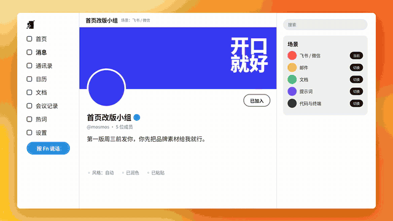

# 模板 44 · 快切换肤蒙太奇 + 润色、去口头禅和热词

参考片：[Boosts by Arc · Meet Your New Internet](https://www.youtube.com/watch?v=N0jMmiCS8oQ)（The Browser Company，2023）

风格：快切换肤蒙太奇 · 同一页面连换配色和字体 · 彩色底大字 · 调色面板 · 闪电删除条 · 层叠窗口 · 地平线字卡 · 弹跳字标

## 复刻了什么

- 桌面壁纸前的白色页面，同一页面连换白、紫、米白、暗色等宽、橙色衬线五套配色。
- 彩色底大字「准备好了吗」「让每一个输入框」「你的输入框」，底色一帧一换。
- 调色面板、终端页、文档页和五种配色的专辑页快速轮换。
- 闪电菜单「去掉口头禅」，口头禅列表和邮件里的「那个，」被删除条一条条去掉。
- 会议表格「提取待办」，转成待办。
- 视觉参考板擦除换肤，层叠窗口 3 / 4 / 5 层，档案页换配色。
- 热词弹窗打开开关，大字「去掉 / 润色 / 记住」，手写出现的新热词卡片，「加入热词」按钮和心形勾「已加入热词」。
- 地平线前升起「你的每一个输入框」，「按一次 Fn」，MosMos 窗口和菜单，弹跳字标，最后像素标志和 mosmos.io。

画面里的产品、文案和界面都来自 [mosmos.io](https://mosmos.io)。画面里的照片和头像是仓库里前面模板已有的 Pexels 和 Open Peeps 素材（见 [ASSETS.md](ASSETS.md)），其余都是代码画的；配乐和音效用 numpy 合成。参考片只用来量时间和看运动方式，仓库里没有它的任何画面、音频或视频。

## 关键数字

| 项目 | 参考片 | 本模板 |
|---|---|---|
| 时长 | 42.14 秒 | 42.125 秒 |
| 帧率 | 23.976 | 24 |
| 画幅 | 1920×1080 | 1920×1080 |
| 剪辑点 | 51 个 | 51 个，时间相同（误差不超过 1 帧） |
| 速度 | 136 BPM | 136 BPM |
| 响度 | −10.5 LUFS | 约 −14 LUFS，真峰值不高于 −1.5 dBTP |

参考片介绍的是给网页换配色和字体的浏览器功能；这里换成 MosMos 的「让每一个输入框都写得更好」：同一页面连换配色字体保留参考片的节奏，内容换成去掉口头禅、润色、会议待办和热词。参考片在 5.792、6.25、27.333 秒有镜头内的硬切换（底色或配色一帧换掉），这里同样做成硬切换，并算进剪辑点（48 个镜头切换 + 3 个镜头内硬切换 = 51）。照片都是仓库里前面模板已有的 Pexels 和 Open Peeps 素材（见 ASSETS.md）。片中的人名、邮件和会议内容都是示例。

## 预览



完整版（720p）：[preview.mp4](preview.mp4)

## 怎么渲染

```bash
cd templates/_engine
npm install
scripts/fetch-fonts.sh   # 一次即可：安装 Noto Sans SC / Noto Serif SC 可变字重（OFL）
RENDER_DIR=/tmp/renders scripts/render.sh 44-arc-boosts
python3 scripts/qa.py ../44-arc-boosts /tmp/renders/44-arc-boosts.mp4   # 可选：剪辑点、响度和抽帧检查
```

`render.sh` 依次运行 `timeline.py`（剪辑点和音效事件）、`audio.py`（配乐）、`master.py`（归一到 −14 LUFS、限制真峰值）、Remotion 渲染，再合成 1080p 成片，并在本目录生成 `preview.mp4` 和 `preview.gif`。中间文件写在 `build/`，不进仓库。

## 文件

- `Film.tsx`：画面
- `timeline.py` / `timeline.json`：剪辑点、动画时间、音效事件
- `audio.py`：配乐和音效
- `meta.json`：规格和参考片信息
- `cuts.json`：参考片剪辑点（逐帧差分量出）
- `analysis.md`：参考片逐镜拆解
- `ASSETS.md`：外部素材来源和许可
