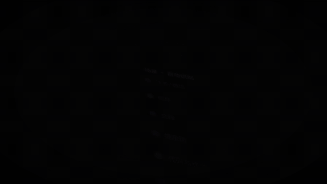

# 模板 45 · 近黑底倾斜数据面板 + 逐字稿、场景和会议总结

参考片：[Introducing Dashboards in Linear](https://www.youtube.com/watch?v=8Njlv_LwlQM)（Linear，2025）

风格：近黑底 · 透视倾斜的数据面板 · 发光曲线、散点、细柱 · 景深虚化 · 淡入淡出的白字标题 · 卡片式面板 · 列表下钻 · 白色字标收尾

## 复刻了什么

- 近黑底上透视倾斜的面板：发光声波曲线和标题「从语音输入，到会议总结和待办」。
- 红色散点「逐字稿 · 每一句话」，场景和润色细柱，悬停提示「邮件 完整专业」。
- 场景散点簇「自动识别场景 / 手动切换」，关键词柱和「会议进行中 · 多人逐字稿」面积图，景深虚化。
- 淡入淡出的白字标题「谁说了什么，接下来做什么」「保留多少原话，由你决定」「你在哪里说，决定我们怎么写」。
- 卡片式面板：场景卡片、光标选择润色档位、会议总结、待办列表和逐字稿下钻。
- 最后像素标志和白色 MosMos 字标。

画面里的产品、文案和界面都来自 [mosmos.io](https://mosmos.io)。这个模板没有用外部照片或录音（见 [ASSETS.md](ASSETS.md)）；配乐和音效用 numpy 合成。参考片只用来量时间和看运动方式，仓库里没有它的任何画面、音频或视频。

## 关键数字

| 项目 | 参考片 | 本模板 |
|---|---|---|
| 时长 | 44.26 秒 | 44.183 秒 |
| 帧率 | 60 | 60 |
| 画幅 | 1920×960 | 1920×1080 |
| 剪辑点 | 5 个 | 5 个，时间相同（误差不超过 1 帧） |
| 速度 | 132 BPM | 132 BPM |
| 响度 | −24.2 LUFS | 约 −14 LUFS，真峰值不高于 −1.5 dBTP |

参考片是 60 fps，本模板也按 60 fps 渲染 1080p 成片；仓库里的 preview.mp4 是 720p、30 fps 的预览。参考片画幅是 1920×960，本模板把内容放在 1080 画面中间同样高度的区域里。参考片介绍的是数据看板；MosMos 没有统计数字，这里的曲线、散点和柱条只作为画面元素，不标任何数值，内容换成它真实有的功能：语音输入、逐字稿、场景、润色和会议总结、待办。

## 预览



完整版（720p）：[preview.mp4](preview.mp4)

## 怎么渲染

```bash
cd templates/_engine
npm install
scripts/fetch-fonts.sh   # 一次即可：安装 Noto Sans SC / Noto Serif SC 可变字重（OFL）
RENDER_DIR=/tmp/renders scripts/render.sh 45-linear-dashboards
python3 scripts/qa.py ../45-linear-dashboards /tmp/renders/45-linear-dashboards.mp4   # 可选：剪辑点、响度和抽帧检查
```

`render.sh` 依次运行 `timeline.py`（剪辑点和音效事件）、`audio.py`（配乐）、`master.py`（归一到 −14 LUFS、限制真峰值）、Remotion 渲染，再合成 1080p 成片，并在本目录生成 `preview.mp4` 和 `preview.gif`。中间文件写在 `build/`，不进仓库。

## 文件

- `Film.tsx`：画面
- `timeline.py` / `timeline.json`：剪辑点、动画时间、音效事件
- `audio.py`：配乐和音效
- `meta.json`：规格和参考片信息
- `cuts.json`：参考片剪辑点（逐帧差分量出）
- `analysis.md`：参考片逐镜拆解
- `ASSETS.md`：外部素材来源和许可
