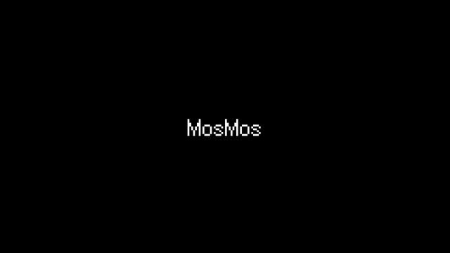

# 模板 46 · 黑底像素字标快切 + 快捷键、场景、润色和热词

参考片：[Introducing Hana - A new canvas for interactivity](https://www.youtube.com/watch?v=ZsYijIY7qBA)（Spline，2025）

风格：黑底像素字标 · 霓虹线框图标九宫格 · 线条动画九宫格 · 科幻 HUD · 浅紫底按键 · 灰底组件拼贴 · 像素字反白高亮 · 等距线框 · 像素菜单 · 扇形卡片 · 彩色几何 · 像素字回声 · 深色画板缩放 · 像素字标收尾

## 复刻了什么

- 黑底像素字标「MosMos」一跳一跳放大。
- 霓虹线框图标九宫格、线条动画九宫格和科幻风会议 HUD。
- 浅紫底按键（关闭 / 标准 / 高级 / Fn / ⇧ / Alt / 说完），一个键被按下。
- 灰底组件拼贴，像素字「一个键，两种用法」和两帧闪白条。
- 等距线框的 Fn 键和快捷键胶囊 Fn / Fn + Shift / Right Alt / Alt + M。
- 像素菜单 语音输入 / 场景 / 润色 / 热词 / 会议 / 待办，高亮逐项移动。
- 扇形卡片翻面，「热词」彩色几何，「会议记录」像素字回声。
- 深色画板和 MosMos 设置面板，镜头在画板上推拉，箭头阵跟着光标转。
- 一帧点阵，片尾像素字标故障闪烁，渐变像素标志，「开口就好」，灰底「mosmos.io」，最后渐变圆和标志。

画面里的产品、文案和界面都来自 [mosmos.io](https://mosmos.io)。除了 Fusion Pixel 像素字体（OFL，见 [ASSETS.md](ASSETS.md)），画面都是代码画的；配乐和音效用 numpy 合成。参考片只用来量时间和看运动方式，仓库里没有它的任何画面、音频或视频。

## 关键数字

| 项目 | 参考片 | 本模板 |
|---|---|---|
| 时长 | 26.73 秒 | 26.667 秒 |
| 帧率 | 30 | 30 |
| 画幅 | 1920×1080 | 1920×1080 |
| 剪辑点 | 23 个 | 23 个，时间相同（误差不超过 1 帧） |
| 速度 | 129 BPM | 129 BPM |
| 响度 | −17.5 LUFS | 约 −14 LUFS，真峰值不高于 −1.5 dBTP |

参考片介绍的是一款交互设计工具；这里换成 MosMos 的快捷键、场景、润色、热词和会议记录。像素字体用 TakWolf 的 Fusion Pixel（OFL，见 ASSETS.md）；深色画板上的缩略图是本片前面镜头的画面。参考片结尾的 3D 渐变球换成渐变圆和像素标志。参考片 7.767 / 8.467 和 22.533 秒有一到两帧的闪白和点阵，这里同样各留一到两帧，算进剪辑点。

## 预览



完整版（720p）：[preview.mp4](preview.mp4)

## 怎么渲染

```bash
cd templates/_engine
npm install
scripts/fetch-fonts.sh   # 一次即可：安装 Noto Sans SC / Noto Serif SC 可变字重和 Fusion Pixel 像素字体（OFL）
RENDER_DIR=/tmp/renders scripts/render.sh 46-spline-hana
python3 scripts/qa.py ../46-spline-hana /tmp/renders/46-spline-hana.mp4   # 可选：剪辑点、响度和抽帧检查
```

`render.sh` 依次运行 `timeline.py`（剪辑点和音效事件）、`audio.py`（配乐）、`master.py`（归一到 −14 LUFS、限制真峰值）、Remotion 渲染，再合成 1080p 成片，并在本目录生成 `preview.mp4` 和 `preview.gif`。中间文件写在 `build/`，不进仓库。

## 文件

- `Film.tsx`：画面
- `timeline.py` / `timeline.json`：剪辑点、动画时间、音效事件
- `audio.py`：配乐和音效
- `meta.json`：规格和参考片信息
- `cuts.json`：参考片剪辑点（逐帧差分量出）
- `analysis.md`：参考片逐镜拆解
- `ASSETS.md`：外部素材来源和许可
