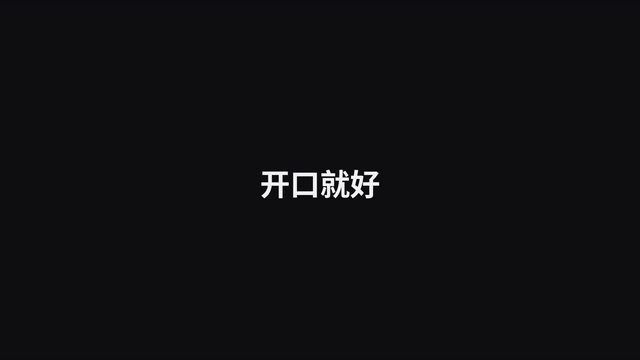

# 模板 47 · 近黑底放大列表 + 场景切换、代码与终端和提示词

参考片：[Introducing Linear For Agents](https://www.youtube.com/watch?v=sbwOQV5zY34)（Linear，2025）

风格：近黑底 · 放大的深色列表 · 多选高亮 · 下拉选择 · 评论线程逐条出现 · 卡片列表滚动模糊 · 文档页与回复 · 白字轮换字卡 · 字标淡出

## 复刻了什么

- 近黑底白字「开口就好」，淡出后是放大的深色列表：几段口述原话。
- 光标多选三行，下拉「切换场景…」列出 自动识别 / 飞书 / 微信 / 邮件 / 代码与终端 / 文档 / 提示词，选中「代码与终端」，几行带上 >_ 标记。
- 活动记录「场景自动识别为 代码与终端」，接着评论线程：口述的需求，MosMos 生成命令「命令已生成 · 按 Enter 执行」，命令粘贴进终端。
- 场景卡片列表滚动模糊，停在「✓ 当前场景」。
- 文档页里逐字出现一段口述，回复写成结构化的提示词和表格。
- 白字轮换「开口写代码 / 写邮件 / 写文档 / 写提示词 / 开口 / 开口就好」，最后像素标志和 MosMos 字标淡出。

画面里的产品、文案和界面都来自 [mosmos.io](https://mosmos.io)。这个模板没有用外部照片或录音（见 [ASSETS.md](ASSETS.md)）；配乐和音效用 numpy 合成。参考片只用来量时间和看运动方式，仓库里没有它的任何画面、音频或视频。

## 关键数字

| 项目 | 参考片 | 本模板 |
|---|---|---|
| 时长 | 32.69 秒 | 32.633 秒 |
| 帧率 | 30 | 30 |
| 画幅 | 1920×1080 | 1920×1080 |
| 剪辑点 | 7 个 | 7 个，时间相同（误差不超过 1 帧） |
| 速度 | 144 BPM | 144 BPM |
| 响度 | −17.4 LUFS | 约 −14 LUFS，真峰值不高于 −1.5 dBTP |

参考片介绍的是把任务交给 AI 代理；MosMos 不做代理，这里换成它真实有的功能：给几段口述原话切换场景，「代码与终端」场景里说出需求生成命令，「提示词」场景里口述写成结构化提示词。界面是代码画的通用暗色列表，不是任何真实软件。片中的命令和需求是示例。

## 预览



完整版（720p）：[preview.mp4](preview.mp4)

## 怎么渲染

```bash
cd templates/_engine
npm install
scripts/fetch-fonts.sh   # 一次即可：安装 Noto Sans SC / Noto Serif SC 可变字重（OFL）
RENDER_DIR=/tmp/renders scripts/render.sh 47-linear-agents
python3 scripts/qa.py ../47-linear-agents /tmp/renders/47-linear-agents.mp4   # 可选：剪辑点、响度和抽帧检查
```

`render.sh` 依次运行 `timeline.py`（剪辑点和音效事件）、`audio.py`（配乐）、`master.py`（归一到 −14 LUFS、限制真峰值）、Remotion 渲染，再合成 1080p 成片，并在本目录生成 `preview.mp4` 和 `preview.gif`。中间文件写在 `build/`，不进仓库。

## 文件

- `Film.tsx`：画面
- `timeline.py` / `timeline.json`：剪辑点、动画时间、音效事件
- `audio.py`：配乐和音效
- `meta.json`：规格和参考片信息
- `cuts.json`：参考片剪辑点（逐帧差分量出）
- `analysis.md`：参考片逐镜拆解
- `ASSETS.md`：外部素材来源和许可
