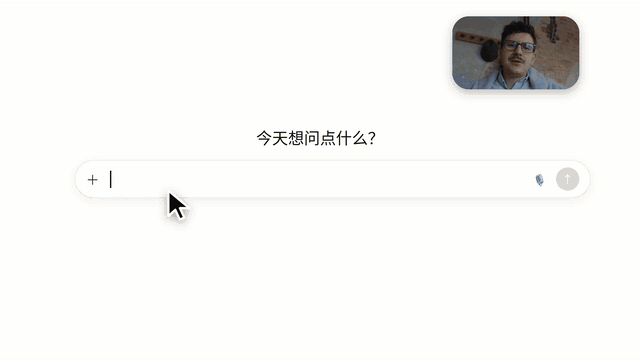

# 模板 48 · 屏幕录制 + 摄像头小窗 + 听写胶囊，从打字到开口

参考片：[Intro to Wispr Flow: voice-to-text AI that turns speech into clear, polished writing in every app.](https://www.youtube.com/watch?v=x6XJIbRksgI)（Wispr Flow，2025）

风格：屏幕录制 · 右上角摄像头小窗 · 白底对话框慢慢打字 · 拉远看桌面再推近 · 底部听写胶囊和烧录字幕 · 邮件、团队聊天、热词、提示词、代码编辑器 · 真人出镜 · 手机 · 设置弹窗 · 官网和地址栏 · 暗色字标收尾

## 复刻了什么

- 白底对话框里慢慢打字，拉远看整个桌面，再推近：打字太慢，按一次 Fn 直接说，长提示词一次粘贴进去。
- 右上角摄像头小窗贯穿全片，中间几段整屏真人出镜，下方字幕条「MosMos / 让文字，重新从声音开始」。
- 邮件：说出邮件，写成完整专业的成稿；甩镜推近。
- 团队聊天私信：说出回复，写成简洁自然的消息再发送。
- 热词页：难认的词加进词库，拉远再推近。
- 提示词渐变页：一句口述的需求整理成结构清晰的提示词卡片。
- 暗色代码编辑器，推近右侧聊天面板：口述的需求生成命令。
- 真人拿起手机：「iOS 即将上线」；Fn + Shift 记整场会。
- 设置弹窗、场景和润色选择弹窗。
- mosmos.io 官网首屏，推近地址栏，最后暗色片尾：像素标志、MosMos、mosmos.io 和平台徽章。

画面里的产品、文案和界面都来自 [mosmos.io](https://mosmos.io)。真人出镜用的是 Pexels 的素材视频，私信头像是仓库里已有的 Open Peeps（见 [ASSETS.md](ASSETS.md)），其余都是代码画的；配乐和音效用 numpy 合成。参考片只用来量时间和看运动方式，仓库里没有它的任何画面、音频或视频。

## 关键数字

| 项目 | 参考片 | 本模板 |
|---|---|---|
| 时长 | 128.36 秒 | 128.35 秒 |
| 帧率 | 60 | 60 |
| 画幅 | 1668×1080 | 1920×1080 |
| 剪辑点 | 18 个 | 18 个，时间相同（误差不超过 1 帧） |
| 速度 | 126 BPM | 126 BPM |
| 响度 | −33.7 LUFS | 约 −14 LUFS，真峰值不高于 −1.5 dBTP |

参考片是 60 fps，本模板也按 60 fps 渲染 1080p 成片；仓库里的 preview.mp4 是 720p、30 fps 的预览。参考片画幅是 1668×1080，本模板把内容放在 1080 画面中间同样宽度的区域里。参考片介绍的是另一款语音输入产品；片中不出现它的名字和标志，所有界面、文案和功能都换成 mosmos.io 上写的：按一次 Fn 开始说、再按一次写好，场景（邮件、飞书 / 微信、文档、提示词、代码与终端）、润色三档、热词、Fn + Shift 记会议；参考片里的手机端功能换成网站上写的「iOS 即将上线」。出镜的人是 Pexels 素材视频里的演员（见 ASSETS.md），不是名人。参考片在 87.167 秒那一下是手部动作，不是剪辑点，所以剪辑点是 18 个。桌面、浏览器、邮件、聊天和编辑器都是代码画的通用界面；片中的人名、项目和内容都是示例。

## 预览



完整版（720p）：[preview.mp4](preview.mp4)

## 怎么渲染

```bash
cd templates/_engine
npm install
scripts/fetch-fonts.sh   # 一次即可：安装 Noto Sans SC / Noto Serif SC 可变字重（OFL）
RENDER_DIR=/tmp/renders scripts/render.sh 48-dictation-intro
python3 scripts/qa.py ../48-dictation-intro /tmp/renders/48-dictation-intro.mp4   # 可选：剪辑点、响度和抽帧检查
```

`render.sh` 依次运行 `timeline.py`（剪辑点和音效事件）、`audio.py`（配乐）、`master.py`（归一到 −14 LUFS、限制真峰值）、Remotion 渲染，再合成 1080p 成片，并在本目录生成 `preview.mp4` 和 `preview.gif`。中间文件写在 `build/`，不进仓库。

## 文件

- `Film.tsx`：画面
- `timeline.py` / `timeline.json`：剪辑点、动画时间、音效事件
- `audio.py`：配乐和音效
- `meta.json`：规格和参考片信息
- `cuts.json`：参考片剪辑点（逐帧差分量出）
- `analysis.md`：参考片逐镜拆解
- `ASSETS.md`：外部素材来源和许可
