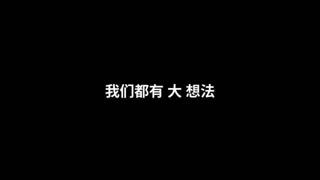

# 模板 49 · 紫色动态字卡 + 文档编辑器，开口写下第一版

参考片：[Introducing Pitch 2.0](https://www.youtube.com/watch?v=tqfeE5G36tM)（Pitch，2023）

风格：紫色与淡紫配色 · 黑底一句话里的关键词膨胀成照片卡 · 打字字卡停在巨字上 · 你好 + 3D 形状 · 渐变按钮输入卡 · 草稿卡片飞起 · VHS 倒带 · 风格选择面板 · 文档编辑器里就地写字 · 场景面板 · 演示模式 · 会议记录 · 紫色字标收尾

## 复刻了什么

- 黑底一句话「我们都有大想法」，「大」字膨胀成照片卡，再换成「值得说出来」和人群照片。
- 淡紫底打字字卡，最后停在巨字「第一步」和闪烁的光标上。
- 紫底「你好，MosMos」，3D 形状滑入，Fn 角标。
- 输入卡片「你想写点什么？」：按 Fn 说出一句需求，点渐变按钮「再按一次 Fn，文字写好」。
- 草稿卡片一张张飞起，「就这样？」，VHS 倒带「REW <<」和「STOP ■」。
- 「现在，按你的方式来写」：风格面板选润色程度，标题卡换成成稿；场景列表选「邮件」。
- 大按钮「开始编辑」拉远成文档编辑器，第二页里「小林」边说边写邮件正文，镜头推近再拉回。
- 「让想法，落成文字」：右侧「场景」面板选「邮件」，「润色」面板选「高级」，点「演示」。
- 演示模式翻到「会议待办」页。
- 「谁说了什么，接下来做什么」：会议记录弹窗，推近逐字稿，展开一行看到待办卡片。
- 巨字「想到了」，「说出来，就写好了」，最后像素标志、MosMos 和 mosmos.io。

画面里的产品、文案和界面都来自 [mosmos.io](https://mosmos.io)。照片来自 Pexels 和 Poly Haven（见 [ASSETS.md](ASSETS.md)），其余都是代码画的；配乐和音效用 numpy 合成。参考片只用来量时间和看运动方式，仓库里没有它的任何画面、音频或视频。

## 关键数字

| 项目 | 参考片 | 本模板 |
|---|---|---|
| 时长 | 81.53 秒 | 81.5 秒 |
| 帧率 | 30 | 30 |
| 画幅 | 1920×1080 | 1920×1080 |
| 剪辑点 | 31 个 | 31 个，时间相同（误差不超过 1 帧） |
| 速度 | 123 BPM | 123 BPM |
| 响度 | −18.5 LUFS | 约 −14 LUFS，真峰值不高于 −1.5 dBTP |

参考片介绍的是一款演示文稿工具的新版本；这里换成 MosMos：输入卡片里按 Fn 说出需求，草稿、风格面板（润色关闭 / 标准 / 高级）、场景列表、文档里边说边写，以及会议记录（多人逐字稿、会议总结、待办事项）。参考片的数据分析面板换成会议记录，发言分布的柱条只作为画面元素，不标任何数值。文档编辑器、演示模式和会议记录是代码画的通用界面，不是任何真实软件；照片来自 Pexels 和 Poly Haven（见 ASSETS.md）。片中的人名、项目和内容都是示例。

## 预览



完整版（720p）：[preview.mp4](preview.mp4)

## 怎么渲染

```bash
cd templates/_engine
npm install
scripts/fetch-fonts.sh   # 一次即可：安装 Noto Sans SC / Noto Serif SC 可变字重（OFL）
RENDER_DIR=/tmp/renders scripts/render.sh 49-pitch-2
python3 scripts/qa.py ../49-pitch-2 /tmp/renders/49-pitch-2.mp4   # 可选：剪辑点、响度和抽帧检查
```

`render.sh` 依次运行 `timeline.py`（剪辑点和音效事件）、`audio.py`（配乐）、`master.py`（归一到 −14 LUFS、限制真峰值）、Remotion 渲染，再合成 1080p 成片，并在本目录生成 `preview.mp4` 和 `preview.gif`。中间文件写在 `build/`，不进仓库。

## 文件

- `Film.tsx`：画面
- `timeline.py` / `timeline.json`：剪辑点、动画时间、音效事件
- `audio.py`：配乐和音效
- `meta.json`：规格和参考片信息
- `cuts.json`：参考片剪辑点（逐帧差分量出）
- `analysis.md`：参考片逐镜拆解
- `ASSETS.md`：外部素材来源和许可
