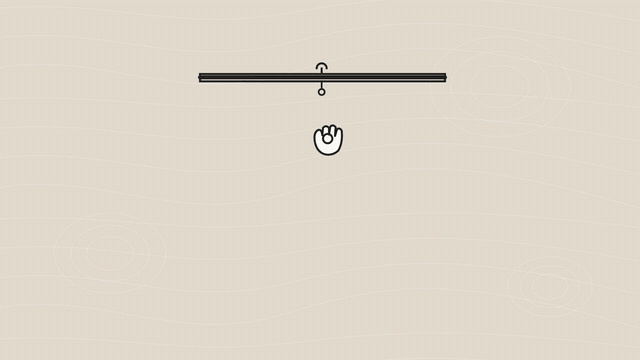

# 模板 50 · 暖米色一镜到底：邮件 → 口述提示词 → 进度表和回复邮件

参考片：[Create polished files in minutes with Sonnet 4.5](https://www.youtube.com/watch?v=Tdg_lkCMzY0)（Anthropic，2025）

风格：暖米色等高线底 · 手绘画板开场 · 一镜到底的屏幕录制 · 推近邮件并划选 · 对话框语音输入后整理成提示词 · 回复里逐条出现的步骤和文件卡片 · 进度表里用语音填一格 · 文档 · 第二段语音请求 · 回复邮件草稿 · 线条图标汇成像素标志

## 复刻了什么

- 米色等高线底，手绘画板被拉下来，画出一段声波。
- 邮件窗口推近，李经理的邮件里划选三条要求。
- 换到对话窗口「下午好，小林」：按 Fn 口述一段带口头禅的需求，MosMos 整理成分点的提示词，拖入附件，发送。
- 回复里逐条出现步骤、会议里的三条待办和两张文件卡片，下载。
- 进度表打开、推近，选中一格，用语音填入「准备中」。
- 进度说明文档滚动；回到对话，第二段口述的请求整理好后发送，回复写好回复邮件，打开邮件草稿。
- 线条图标展开成九宫格（中间是麦克风），收拢成像素标志和 MosMos 字标。

画面里的产品、文案和界面都来自 [mosmos.io](https://mosmos.io)。这个模板没有用外部照片或录音（见 [ASSETS.md](ASSETS.md)）；配乐和音效用 numpy 合成。参考片只用来量时间和看运动方式，仓库里没有它的任何画面、音频或视频。

## 关键数字

| 项目 | 参考片 | 本模板 |
|---|---|---|
| 时长 | 79.48 秒 | 79.467 秒 |
| 帧率 | 30 | 30 |
| 画幅 | 1920×1080 | 1920×1080 |
| 剪辑点 | 4 个 | 4 个，时间相同（误差不超过 1 帧） |
| 速度 | 152 BPM | 152 BPM |
| 响度 | −36.9 LUFS | 约 −14 LUFS，真峰值不高于 −1.5 dBTP |

参考片介绍的是 AI 助手直接生成文件；MosMos 是语音输入，不生成文件，这里让 MosMos 做它真实有的事：在对话窗口里按 Fn 口述需求，整理成要求明确的提示词（场景：提示词），在进度表里用语音填一格（润色关闭，原样直出）。对话窗口、回复和文件卡片是代码画的通用「AI 助手」界面，不是任何真实软件，也不代表 MosMos 的功能；片中的人名、项目和内容都是示例。

## 预览



完整版（720p）：[preview.mp4](preview.mp4)

## 怎么渲染

```bash
cd templates/_engine
npm install
scripts/fetch-fonts.sh   # 一次即可：安装 Noto Sans SC / Noto Serif SC 可变字重（OFL）
RENDER_DIR=/tmp/renders scripts/render.sh 50-claude-polished-files
python3 scripts/qa.py ../50-claude-polished-files /tmp/renders/50-claude-polished-files.mp4   # 可选：剪辑点、响度和抽帧检查
```

`render.sh` 依次运行 `timeline.py`（剪辑点和音效事件）、`audio.py`（配乐）、`master.py`（归一到 −14 LUFS、限制真峰值）、Remotion 渲染，再合成 1080p 成片，并在本目录生成 `preview.mp4` 和 `preview.gif`。中间文件写在 `build/`，不进仓库。

## 文件

- `Film.tsx`：画面
- `timeline.py` / `timeline.json`：剪辑点、动画时间、音效事件
- `audio.py`：配乐和音效
- `meta.json`：规格和参考片信息
- `cuts.json`：参考片剪辑点（逐帧差分量出）
- `analysis.md`：参考片逐镜拆解
- `ASSETS.md`：外部素材来源和许可
